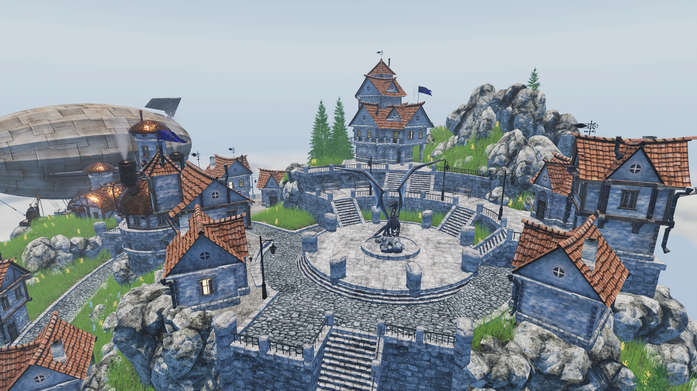
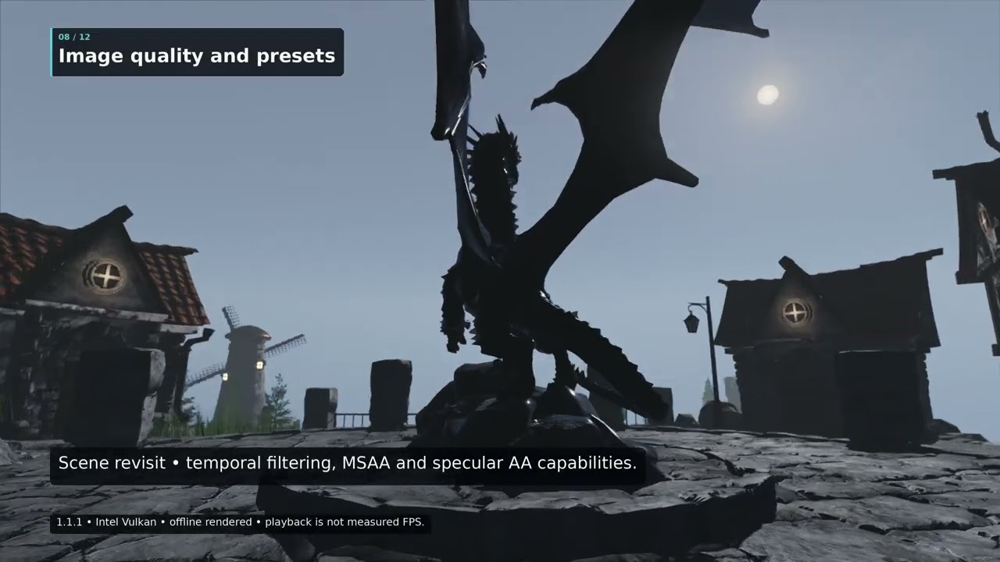

# HeavenBench

**HeavenBench** is a CPU and GPU benchmark for Linux, Windows, macOS on Apple Silicon and Android. Take a tour through the floating islands and medieval village of the original Unigine Heaven scene, compare hardware performance, or explore the world at your own pace.

*Captured in released HeavenBench 1.1.1 on Linux with Intel Vulkan, Balanced System and original textures, at 3840×2160; shown at 1920×1080.*

**Downloads:** [HeavenBench 1.1.1 for Linux, Windows, macOS and Android](https://github.com/dev-zetta/HeavenBench/releases/tag/v1.1.1), with separate experimental Linux FSR 3.1 and Windows FSR/DLSS-adapter packages. Generation remains off by default. The Android APK is development-signed with a different certificate from published 1.1.0 and cannot update that installation in place; back up imported assets and user data before uninstalling and reinstalling. [Release readiness](docs/RELEASE_READINESS.md) records package verification and remaining rendering/device limitations. See the [changelog](CHANGELOG.md) for the development history.

The macOS download requires **Apple Silicon (M1 or newer) and macOS 15+**. It is ad hoc signed, without notarization, and full rendering on a physical Mac remains unverified. See [macOS setup and launch instructions](docs/MACOS.md).

For future trusted Android CI builds, [persistent signing](docs/ANDROID_SIGNING.md) provides a retained update identity through a separate post-build step. Published 1.1.1 keeps its original development certificate and assets; moving from it to the new identity requires one final backup/uninstall/reinstall migration. The APK remains debuggable development software, and subsequent official updates require the same application ID and key with an incremented versionCode.

## Watch the videos

[Watch the HeavenBench 1.1.1 showcase in 4K60 (9:30)](https://youtu.be/ChFH_zX_q4U): rendering features, comparisons, benchmark reports, the microprofiler and Android controls. Cinematic sequences are offline rendered; their playback frame rate is not measured benchmark performance. Retained UI, browser and tablet inserts are labelled `Archive 1.0.0`.

[Watch the narrated update: what changed since 1.0.0 (4:24)](https://youtu.be/f4JlHzZyq1w): lighting changes, experimental frame generation, GPU selection, cache and loading improvements, rain optimization and OpenGL fixes.

See the [video production notes](docs/VIDEO_PRODUCTION.md) for source bindings, credits and the editing workflow. The [original 1.0.0 showcase](https://youtu.be/v-s5fNxlnVw) remains available as an archive.

## Features

- **CPU and GPU benchmarking:** a repeatable CPU workload and a 26-scene camera tour, with Overall, CPU and GPU scores, FPS and frame-time statistics.
- **Optional 2K and 4K assets:** use enhanced texture packs alongside the original assets, with selectable Original, High 2K and Ultra 4K quality. These are generated high-resolution textures; see the [texture extension guide](docs/HIRES_TEXTURE_PIPELINE.md) for preparation and compatibility.
- **Modern materials and lighting:** physically based shading, reflective and emissive lamp glass, clear coat, anisotropy, subsurface shading, environment lighting, soft shadows and contact shadows.
- **Reflections and post effects:** screen-space reflections and indirect lighting, ambient occlusion, bloom with lens dirt, depth of field, anti-aliasing and color grading.
- **Day, night and weather:** a procedural sky with the Moon and stars, moonlight, night-time street lamps with soft local halos, volumetric clouds and fog, sun rays, rain, splashes and wet surfaces.
- **An animated world:** wind-driven grass and dense foliage, animated meshes, cloth and rope simulation, lit smoke, particles, heat haze and view-dependent lamp flares.
- **Adjustable geometry and quality:** rendering presets, displacement and tessellation levels, GPU instancing and skinning, and settings labels indicating estimated CPU, GPU and memory impact.
- **Optional Vulkan VRS:** full-rate, 2×1 and 2×2 shading controls with explicit hardware fallbacks. Defaults off; see the [actual Heaven measurements and quality trade-offs](docs/VARIABLE_RATE_SHADING.md).
- **Responsive loading:** background scene preparation with stage text and a progress bar, plus reusable geometry caches.
- **Reports and diagnostics:** saved JSON and self-contained HTML benchmark reports, a live CPU/GPU microprofiler with exportable task timelines, optional [GPU invocation and shader diagnostics](docs/GPU_DIAGNOSTICS.md), and isolated rendering test scenes using simple objects and real scene meshes. The separate [GPU compute lab](docs/INTEL_GPU_FEATURES.md) tests FP16 and signed INT8 reference, packed-dot and cooperative-matrix workloads without affecting the Heaven score.
- **Experimental frame generation:** separate optional Vulkan FSR 3.1 packages for Linux/Windows and a Windows DLSS adapter, with separate render/presentation counters and diagnostic, unscored tours. Generation defaults off; proprietary NVIDIA runtime plugins are supplied separately and NVIDIA runtime execution remains untested. See [requirements, build options and validation limits](docs/FRAME_GENERATION.md).
- **Desktop and Android controls:** free exploration, accessible benchmark cancellation and settings, plus Vulkan rendering, an OpenGL fallback and HDR10 output on compatible native-Wayland Linux displays.

The [rendering feature guide](docs/FILAMENT_RENDERING_FEATURES.md) describes presets, supported effects and their limits. Rendering updates, features and texture choices change the workload; compare benchmark results using matching application versions and settings.

## Get started

HeavenBench uses the original Heaven scene assets, which are supplied separately from the application. Prepare the shared `assets.zip` once, then use it on any supported platform.

1. Follow [Getting started](docs/GETTING_STARTED.md) to prepare the assets and launch the application.
2. Choose **Benchmark** on desktop or **Run benchmark** on Android. Choose **Explore** on Android to browse the scene without starting a scored run.
3. Open the saved HTML report after a completed run. Compare results made with matching application and score versions, workloads and settings.

For source builds and package creation, see [Building HeavenBench](docs/BUILDING.md). The [documentation index](docs/README.md) links controls, troubleshooting, rendering features and developer guides.

## Credits and license

HeavenBench is developed by Gabriel Max. It builds on Google Filament and other open-source projects, and its asset tools grew from Luigi Auriemma's `uniginex` extractor. The original Heaven scene belongs to UNIGINE. See [credits and third-party notices](docs/CREDITS.md) for acknowledgements and attribution.

Project changes are licensed under [GPL-3.0-or-later](LICENSE). The original extractor retains its GPL-2.0-or-later notice; third-party code and assets keep their own licenses. Original, extracted and derived Heaven assets are not relicensed by this repository.
