# Actual-scene visual audit

This records the September 30, 2026 autonomous inspection of the actual rendered scene, including all 26 authored tour segments, feature on/off pairs, material/quality variants and targeted closeups. A successful capture receipt establishes that the requested application frame and metadata were produced; it does not by itself establish a correct image, original-engine parity, smooth animation, or physical HDR display acceptance. Historical reports and their scoped current status remain in [KNOWN_BUGS.md](KNOWN_BUGS.md).

## October 9 night lighting checkpoint

The night correction uses one celestial direction and horizon gate for the visible full-Moon approximation, direct moonlight and cloud lighting. Below-horizon direct sunlight no longer outranks the Moon for directional shadows. Star brightness uses an independent hash component instead of reusing the rare-star selection value, which had restricted selected stars to the dim end of the brightness range. Existing rain, fog and cloud attenuation remain; an obscured or off-camera Moon is not a missing-disk failure. These changes do not raise global exposure or establish astronomical lunar photometry.

Smoke now receives scene lighting instead of retaining the former fixed unlit night palette. Authored local-light shadow eligibility is preserved, so a lamp explicitly authored without shadows does not acquire an opaque enclosure shadow when global local shadows are enabled. Eligible lights still cast shadows. Lens flares use identified visible lamp sources or uniquely associated actual torch-flame origins and follow live light positions; ambiguous associations do not invent a source. Original assets, particle geometry and motion remain unchanged. Only `heaven_sky.filamat` and `heaven_smoke.filamat` change; the other 32 packages retain bytes.

Both complete native Vulkan/Wayland and OpenGL/X11 suites pass 50 cases, skip four documented reference/music-asset checks and fail zero. Seven host CTest entries pass, with the opt-in graphical entry separately skipped. Actual smoke FLOAT controls exercise darkness, neutral/colored IBL, point lighting and return-state repeatability; an authored lamp illuminates 1,712 selected ground pixels while a separate eligible-light blocker still suppresses 324 receiver pixels. The celestial state fixture checks real light directions and shadow options; it does not substitute for sky pixels. Full OpenGL execution also exposed stale cached-program identity after destruction. Clearing that identity and its GL binding before object-address reuse fixes the ambient-particle failure; removing only this guard reproduces it. The distributed patch/pins preserve all 52 prior paths and reconstruct tree `20eced9b901fd448fe55d671fd7db5bb6a6a1f47` from the pinned public base.

The final maintained night manifest completes seven cases and fourteen frames per API, all captures successful with exit 0, on Linux renderer SHA-256 `d7bdf1eaa22758966f628f7f5067bab0d9ec209b6bd9b8b2afd9a2d2c55146b2`. Qualified clear/rain sky and street-lamp flare on/off views account for five Vulkan cases byte-identical to their pilots, including the unchanged daytime sky control. The two final airship flare cases supersede their pilots after the staged torch-emitter integration. Reviewed native views show a centered lunar disk and stars, flares inside the authored lamp enclosure, improved lamp spill and removal of the fixed white chimney plume. These bounded views do not establish original-Heaven particle parity or complete night-scene acceptance; the exact user camera is unavailable.

The matching ARM64 development APK SHA-256 is `ab0170692f0d78743815253bae4eb49999556b602d4cb06fbb236e3d1710ee1c`, installed with the same signer and exact readback. Short OnePlus trials cover night smoke, daytime smoke and night lamps, each with confirmed renderer startup, saved-setting restoration, no safety alarm and rendering stopped afterward. The first daytime tap did not start the renderer; its failed attempt is retained separately from the successful retry. Sampled thermal status stays 0, maximum CPU temperature is 60.6°C and battery temperature 25.1°C. These are live ADB screenshots; scrcpy was unavailable. Bright window-surround flecks recur in matched lamp views from both this APK and the preceding `71dbc6dc…` APK, so they predate the night correction; their cause and full Android appearance remain open. The final APK is restored with exact readback after that comparison. The trials do not establish sustained FPS, thermal endurance or a complete tour.

Commands, source/reference witnesses, material preservation, failed controls, negative guard reproduction and terminal results remain under `build/night-lighting/20261009/`, principally `final-visual-verification.json`, `visual-comparison.json`, `material-preservation.json`, `validation/final-*`, `device/` and `vendor-patch/verification.json`. The broader Windows, package, full-tour, thermal, HDR, signing and release gates remain open.

## Closed house and roof displacement joins

The October 8 report concerns narrow background openings around walls, roof caps and shutters. Matched original-house2 views reproduce the wall slit and V/horizontal roof-cap gaps with displacement active; zero Scale and the corrected master switch close them. The previous Off switch skipped CPU subdivision/preparation while ordinary material vertices still displaced, invalidating its use as a neutral-geometry control. Source mesh positions and UVs are retained; no source welding or texture-coordinate repair is applied.

The generic constraint collects uniquely paired closed boundaries from active source surfaces before neutral subdivision/cache replacement. After loading or generating neutral topology, it reduces only displacement magnitude at the paired join, with local smooth transitions toward the authored interior field. Matching handles reciprocal complete chart chains with unequal segmentation and excludes unmatched open edges, ambiguous pairs and inactive surfaces. Exact compatible position/UV/raw-normal copies share transition weights; positions, UV0/UV1, normal directions, tangents and indices keep their original bits. Color, cascade shadows and shared depth consume the same constrained magnitude. Neutral archives retain their existing format and bytes; prepared-cache signatures include the constrained field.

Local transition widths use authored displacement amplitude, a conservative minimum affine instance stretch and per-vertex filtered-height envelopes. The envelope includes original/requested texture selections, High2K's starting mip, periodic texel-center bilinear reconstruction and the mip range where distance fade is active. BC4/BC5 interpolants use their complete local endpoint hull, preserving exact endpoint and special zero/one selectors. Other compressed formats and unsupported inputs log a conservative unsigned envelope. A triangle guard limits only the fade-added displacement derivative to 1.0 relative to the triangle's minimum-weight-scaled original field; it is not a global self-intersection or original-height/normal smoothness certificate. Tiny nonzero-area triangles participate instead of certifying zero slope. Degenerate and rounded-stall triangles lower their incident groups to a verified common binary-power ratio and requeue their neighbors; a final full validation precedes attribute commitment. Real house3 roof and airship-generator probes now finish with zero unresolved triangles instead of exhausting local relaxation on unequal rounded ratios. Unsupported transforms or an unresolved guard retain the original field and log the reason.

Rejected proposals remain under `build/visual-audit/seams-20261008/` and `build/first-release/20261008/seam-shutter-regression/`. A fixed 10–50 mm transition closed the gaps but introduced a shutter notch. Global widening let one thin triangle flatten the roof; a universal height range still suppressed excessive relief after making relaxation local. A tighter CPU-decoder byte allowance failed real constant-BC4 native regressions on both APIs, so the retained envelope uses endpoint hulls instead of assuming hardware palette precision. The intermediate 0.5 derivative limit also exposed an overly broad straight ridge-under strip and failed relaxation on degenerate house3/generator triangles. The retained 1.0 policy keeps more relief and narrows that strip while preserving the finite derivative bound. The strip remains straighter than the earlier unpinned roof: this visible near-seam attenuation is an appearance tradeoff, and the separate 20 mm bounded-refinement limit does not bound this attenuation. The maintained manifest adds grazing-angle shutter views specifically to catch the first visual regression.

The Geometry selector and `--tess-level disabled|moderate|normal|extreme` use the original enabled multipliers 0.75/1/1.5 for Scale, Factor and Distance. Disabled now gates ordinary color/shadow/shared-depth displacement together and preserves the numeric tuple; manual values derive Custom. Later CLI arguments win. These controls retain existing subdivision and bounded-preparation budgets and do not promise proportional triangle counts.

The October 9 verification freezes Linux renderer SHA-256 `fd179172f2dc94100bd5cd01c1589a0a85fadedd4ec239ff54e98acd7f4dffa0` and seam helper `1639431d3a6db325e634f9c4e4f6ea69907070e8a9e30585d042fbc30698c816`. Five host suites pass; the disabled graphical CTest entry skips. Separate complete native Vulkan/Wayland and OpenGL/X11 suites each pass 46 cases, skip two unavailable-reference comparisons and fail zero, including 99 real height-envelope queries per API. The changed seam/scene/fixture code and named-level/master-switch code pass their targeted strict Clang21 checks. No project material package, shader or vendored Filament source changes in this seam correction.

Both maintained 18-case level capture runners finish with status 0 on that renderer. The first asset context lacks three cloud textures and lens dirt; its reusable authored-input QA fails all cases, and these failures are preserved. A separate additive context supplies the four exact originals while preserving every shared runtime asset and the high-resolution archive. Both corrected-context runners again finish 18 cases/18 frames with status 0. Each strict QA replay then verifies 15 original-quality cases with zero resource flags and rejects the three Custom-4K cases for 74 texture-fallback events on Vulkan and 103 on OpenGL; the complete 18-case QA remains exit 1. These 4K images are limited diagnostics, not fully qualified texture coverage. The gap, cap and grazing-shutter appearance is reviewed across both APIs and all controls; existing interior relief remains visible. This is focused seam coverage, not a new full 87-case feature matrix or original-engine parity proof.

Six original-scene Vulkan cameras retain two frames each, covering roof a/b, morning/afternoon, a stone wall and a village ledge. All six runners exit 0 and all twelve products replay correctly. No unresolved closed-seam or prepared-cache validation diagnostic occurs. The 427,340,459-byte neutral archive remains SHA-256 `9452f1fcf92ade093e98a171ea66604e20138616fa15becb40c20a36e51aa701` before/after this batch. Reviewed roof joins retain no new bright slit or tear; the straighter ridge-under strip remains the stated attenuation tradeoff. Local morning/afternoon junction changes between the two frames stay within 3/4 RGB8 levels. A larger changing grass/silhouette region also changes in the prior fixed-band control; these short sequences do not certify general temporal stability.

The matching ARM64 debug APK is 20,315,287 bytes, SHA-256 `7c04a76e8e93e6e974c4e2eaaed11384a1c22a89977966fdb575bba01ae94f77`. The canonical Android build, signature, ZIP/JNI and 16 KiB alignment checks pass; lint reports zero errors and 46 upstream SDL warnings. Installed readback on the OnePlus OPD2415 matches exactly. Saved low settings remain byte-identical at `37d65207865ae61bc42309ea3d5654eb76cb712f0bde787b5fa2f23bbb7f87fc`, with tessellation disabled and rendering stopped. This installation does not establish Android displacement-on appearance, sustained FPS, physical 16 KiB compatibility or release acceptance. Commands, source/binary/input identities, failed alternatives, QA flags, device receipts and independent reviews remain under `build/visual-audit/seams-20261008/` and `build/first-release/20261008/closed-seam-source-independent-review/`.

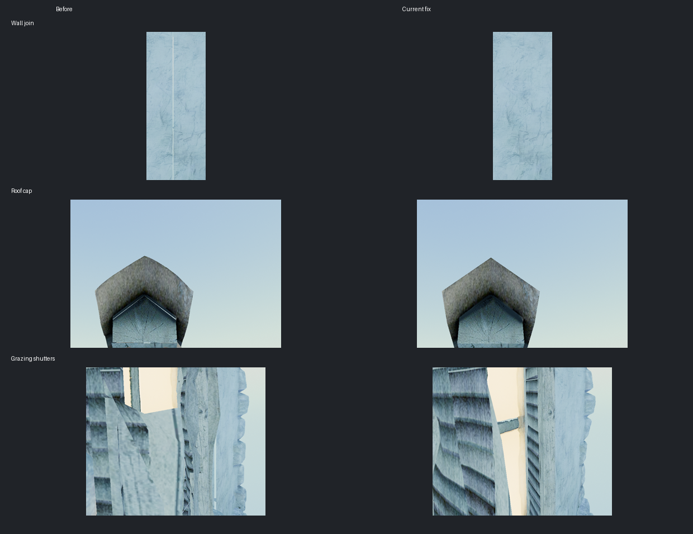

## Reproducible inputs and outputs

The application now supports `--capture FILE.ppm`, `--capture-frames N`, an explicit `--camera-pose x,y,z,yaw,pitch` or `--camera-tour-time SECONDS`, and `--camera-fov DEGREES`. A fixed tour sample retains its authored time of day and depth-of-field state; an explicit pose uses the configured hour. `--capture-tour-motion` instead advances from the requested tour start at the capture simulation rate. An explicit FOV overrides the authored FOV in both modes.

Capture mode defaults to advancing simulation at 1/60 second per accepted frame, freezes floating-island offsets by default, suppresses the overlay and camera input, and supplies the same time to material animation. `--capture-floating-motion` keeps the free-fly island animation active. Rejected presentation attempts do not consume a simulation step or a requested frame. Particle and skeletal animation remain active. The ordinary default of 90 accepted frames therefore captures at 1.5 simulated seconds; effects with a longer buildup use an explicit larger count. Fixed inputs help isolate changes, but do not promise identical pixels across graphics APIs, drivers or hardware.

`--capture-count N` records 1–600 consecutive accepted frames in one application run, starting at `--capture-frames N`. The first image uses the supplied name; subsequent images insert `.000001`, `.000002`, etc. before its extension. Every image has its own metadata and effective configuration, including sequence index, simulation time and floating-island state. This preserves temporal history between captures and allows flickering shadows to be inspected rather than inferred from a single still. Readback and disk writing synchronize each captured frame, so these sequences are visual evidence, not throughput measurements. A runner manifest uses `"count": 16` (or another bounded count); its receipt validates and hashes every frame, and resume refuses an incomplete or modified sequence.

`--capture-fps N` changes the deterministic simulation step (1–240 Hz); it does **not** limit rendering throughput. `--capture-realtime` uses the ordinary wall-clock simulation and renderer shader clocks instead, with no fixed step. The manifest equivalents are `"fps": 15` and `"realtime": true`, mutually exclusive. Every sequence requires strictly advancing timestamps. Both modes retain capture readback overhead and must not be used to quote FPS.

`--profile FILE.json --profile-seconds 65` runs the fixed camera without screenshots or the overlay, leaves ordinary scene animation active, excludes the first two seconds, and requires at least 60 measured seconds. Its JSON includes accepted-frame intervals, CPU submission stages, the asynchronous last-completed whole-frame GPU time, effective settings and hardware/driver identity. GPU samples can lag or repeat; they are not individual render-pass timings. This action exits after measurement and cannot be combined with captures or a scored benchmark.

The earlier desktop-only validation stage deferred Android builds. The user subsequently authorized the connected OnePlus tablet and cross-platform release preparation. Dated Android receipts below qualify only their exact installed payload and exercised settings; historical APKs do not validate later source changes.

SDR output is a lossless P6 RGB8 PPM read from the fully composed frame. HDR output consists of `FILE.ppm`, a diagnostic SDR preview, and `FILE.pq.pfm`, float32 PQ-encoded Rec.2020 RGB before swapchain quantization. The HDR audit target reuses the production encoder and already-composed scene/UI layers; it does not render a second scene. PFM rows are bottom-up and the scale sign identifies byte order. The preview decodes PQ to nits, converts Rec.2020 to sRGB primaries, divides by paper white, applies per-channel Reinhard mapping, and applies the sRGB transfer function. Its brightness and highlight color are properties of that diagnostic mapping, not a photograph or measurement of the display.

Each capture also writes `.ppm.json` with the actual pose, FOV, hour, simulation time, dimensions, API and driver, and `.ppm.config.json` with effective settings. GPU readback completion is checked before files are reported as complete. The HDR validator requires correctly sized finite PQ samples in [0, 1] and retains the raw-file hash as well as the preview hash.

The Linux runner [scripts/visual_audit.py](../scripts/visual_audit.py) creates an explicit configuration per case, launches captures sequentially with timeouts, and records the command, exit code, binary and input-data hashes, selected runtime/driver environment, effective configuration, output hashes and log hash in `results.json`. `--resume` reuses only matching, verified products; changed raw HDR bytes or a failed rerun cannot inherit an earlier successful preview. The runner uses the Linux wrapper and process-group interface; its mocked orchestration tests do not establish native Windows capture support.

```bash
# Inspect the checked-in case inventory without starting a renderer.
python3 scripts/visual_audit.py --suite all --list

# Standard 135-case inventory, or the full 169-case audit including regressions.
python3 scripts/visual_audit.py --manifest docs/visual-audit-cases.json \
  --data assets --output build/visual-audit/full-vulkan

# Repeat a selected case through the actual OpenGL fallback.
python3 scripts/visual_audit.py --suite tour --case '^tour-20$' \
  --api opengl --data build/visual-audit/assets \
  --output build/visual-audit/opengl-night
```

## Asset coverage

The older local base ZIP had 407 entries and omitted the three legacy-cloud textures. An enabled feature with missing inputs is not evidence that its rendering path was exercised. A fresh pack was generated headlessly from the retained extracted originals, with `--clouds`, under `build/visual-audit/assets/assets.zip`; the existing base and high-resolution archives were preserved. The new pack contains 410 ZIP entries and is 321,462,213 bytes, SHA-256 `889fa277add0691cc9f0f4a5152e61c197dd4cf0a762d15bc422135fcbf23eb4`. The adjacent high-resolution ZIP is a symlink to the retained generated archive. Commands, input/output fingerprints, CRC validation and preservation checks are in `build/visual-audit/complete-assets-receipt.json`.

The release asset builder already requests the legacy-cloud assets. Its ZIP validation now also requires every optional feature input from the runtime inventory, including all three cloud textures, and rejects missing or empty entries even when the archive manifest is internally consistent. The ordinary used-asset packer's selective policy remains intact. The 32 builder regressions pass in `build/visual-audit/asset-builder-required-features.log`; this check prevents an older or incorrectly configured helper from silently publishing an incomplete release base pack.

## Run inventory and validation

All runs below use the Radeon AI PRO R9700 on this Linux workstation. Vulkan/native Wayland reports RADV Mesa `26.0.8-1ubuntu0.3`; the forced OpenGL/X11 fallback reports radeonsi Mesa `26.0.0-devel`. Most views are 1280×720 with original textures; the high-resolution texture and 3840×2160 adaptive-resolution cases declare their different inputs explicitly. No concurrent second renderer was used. Capture timings are diagnostic execution times, not benchmark measurements.

Earlier retained batches contain 270 successful, independently verified captures across successive fixes. The executable suffixes below identify preserved local binaries under `build/renderer/heaven_benchmark.visual-*`; receipt files retain their complete SHA-256 values. These batches must not be presented as 270 runs of one final executable.

| Receipt folder under `build/visual-audit/` | Captures | Executable suffix | Scope and version boundary |
|---|---:|---|---|
| `full-vulkan` | 169 | `candidate` | [Main manifest](visual-audit-cases.json): complete tour, feature pairs, variants, motion and HDR; before lens/grass/contact/emission follow-ups. |
| `supplemental-vulkan` | 57 | `final` | [Supplemental manifest](visual-audit-supplemental.json): targeted materials/effects, DOF/window isolation and corrected grass; before contact receivers and emission eligibility. |
| `release-vulkan` | 30 | `release` | Tour, contact pair and HDR with receiver opt-in; exposed the remaining depth-resolution and synthetic-light defects. |
| `release-dynres` | 2 | `release` | [4K adaptive-resolution pair](visual-audit-dynres.json); internal scale reaches 0.5×0.5 when enabled and stays 1×1 when disabled. |
| `release-opengl` | 7 | `release` | [OpenGL manifest](visual-audit-opengl.json): day/night, clouds, heat haze, grass, lens and cloth. |
| `contact-isolation` | 5 | `eligible` | Authored emission-state fix included; isolates half/full structure depth and TAA independently before the automatic depth policy. |
| `verified-vulkan` | 34 | `verified` | [Final manifest](visual-audit-final.json): all 26 tour views, HDR day/night, window bloom, port flares and contact pairs with every runtime fix included. |
| `verified-dynres` | 2 | `verified` | Repeats the 4K adaptive-resolution pair with all fixes; actual scales remain 0.5×0.5 and 1×1. |
| `verified-opengl` | 7 | `verified` | Repeats the seven OpenGL views with all fixes; no additional visible API-specific failure found. |

All 43 final captures exit zero and pass the independent receipt checker (`independent-verified-43.json`), bringing these staged batches to 313 successful captures. Their executable SHA-256 is `5bdad52c5472b15b6b099d6ea1b59910b9899e09fd06a6eefaa28cf95458b2e4`. Full-scene review confirms the removal of the bare-bracket flares and the severe contact-depth stippling while retaining lamps, windows and readable night geometry. VA-15's edge strip, VA-18's window steps and VA-16/19's grass appearance remain visible; these successful execution receipts do not close those issues. Three OpenGL views also have same-executable Vulkan references; the other four use earlier Vulkan reference captures and therefore do not establish isolated API pixel parity.

The final GPU harness passes 35 cases, skips two original-reference parity placeholders and fails zero in each of Vulkan SDR, Vulkan HDR and OpenGL. All three processes exit zero. It uses loose originals for the two real-audio cases, avoiding the earlier ZIP-only skips. Coverage includes actual-material readback, camera/DOF/live lighting state, resize/fullscreen, rejected-frame/history ownership, adaptive resolution, lamp translation/distance fading and source eligibility. The seeded host/CLI CTest selection passes all three entries. The independent material check confirms that all 33 embedded version-77 packages match their `.filamat` bytes. Receipts are `final-gpu-receipt.json`, `independent-material-gpu-final.json` and `emission-host-tests.log`.

The Docker-built AppImage additionally completes eight Vulkan/HDR captures and two OpenGL captures through its extracted `AppRun`, bundled SDL/libraries and packaged resources. All ten processes exit zero and pass independent image/configuration/metadata/PQ validation, bringing the recorded batches to 323 successful captures across audit iterations. These final package views cover day/night, HDR day/night, lamp-flare on/off and contact-shadow on/off; they do not substitute for every earlier feature pair. The actual packaged renderer SHA-256 is `4ea16f9bd14b45112e93e3314a32f5fa4cb901cea498061ccd23ead276fa920e`. `package-runtime-receipt.json` records the AppImage, launcher, executable and source-manifest hashes separately, and `independent-packaged-10.json` verifies the outputs. Exact package/source checksums and remaining platform gates are in [RELEASE_READINESS.md](RELEASE_READINESS.md).

## Reviewed findings and evidence

Paths below are local, ignored audit artifacts. Their receipts identify the actual executable used; a folder name containing “final” is not a claim that every visual case has passed.

| ID | Finding and bounded result | Evidence under `build/visual-audit/` |
|---|---|---|
| VA-01 | The night sky was effectively black because the daylight lux conversion also attenuated already-scaled stars, Milky Way, moon and night-floor radiance. Applying the conversion before those sources restores faint stars in the reviewed night frames. | `first-captures/tour-20.*`; `first-fixed-scenes/night-scene.*` and `night-wide.*` |
| VA-02 | Volumetric clouds retained fixed bright white lighting at night. Their illumination now follows solar intensity with a dim moon contribution while preserving the daytime reference. The conspicuous white lower-right cloud banks are absent from the reviewed corrected night scene. | `isolate-before/193_25-volumetric_clouds-*`; `first-fixed-scenes/night-scene.*` |
| VA-03 | Volumetric fog produced flat gray silhouettes and a sharp boundary between distant geometry and clear sky. The corrected integration covers the finite medium for both geometry and sky, follows scene illumination, and composites premultiplied scattering consistently. Rock and airship surface detail is visible in the corrected night view. | `first-captures/tour-20.*`; `isolate-before/193_25-volumetric_fog-*`; `first-fixed-scenes/night-scene.*` |
| VA-04 | The first HDR night preview had conspicuous grain across dark surfaces and sky. SDR-sized temporal dithering had been applied in the linear HDR target before PQ encoding. Disabling that dithering only for HDR removes the grain in the reviewed replacement capture. | `first-fixed-scenes/hdr-night.*`; `final-probes/hdr-night.*`; `review/hdr-dither-comparison.png` |
| VA-05 | Capture FOV previously reached metadata without reaching every camera/fullscreen pass. The renderer and affected depth/composite features now use the actual FOV. Probe metadata records 30 and 90 degrees respectively. A moving-tour probe starting at 17 seconds reaches the same 18.5-second pose as its fixed reference after 90 accepted frames. | `final-probes/fov-30.*`, `fov-90.*`, `moving-tour.*`, `moving-tour-reference.*` |
| VA-06 | The synthesized boiler smoke origin used the mesh origin plus height, although that origin is displaced from the chimney. Placement now uses the transformed top-rim center and keeps the particle frame upright. A four-second close capture confirms the plume above the chimney; original-effect timing and appearance parity remain unconfirmed. | `first-fixed/boiler.*`; [boiler_smoke.h](../benchmark/src/engine/boiler_smoke.h); [unit_boiler_smoke.cpp](../benchmark/tests/unit_boiler_smoke.cpp) |
| VA-07 | Enabling legacy clouds with complete textures whitened foreground buildings and ground. Correcting the local/world ray mismatch exposed an independent composition error. A device-domain far-plane quad with geometry depth testing fixes foreground occlusion; the complete-asset street pair now agrees to within one RGB8 level. | `legacy-clouds-before/0_8-clouds-*`; `final-probes/legacy-clouds-*`; `full-vulkan/clouds-*` |

Additional configuration and temporal defects found during the feature audit are tracked separately from the pixel observations above:

| ID | Defect | Correction and verification target |
|---|---|---|
| VA-08 | Weather/post-process refresh disabled camera-owned DOF. | Preserve the camera's optical state, with an explicit DOF feature gate; held and moving-tour pairs plus GPU state checks. |
| VA-09 | Wet reflection restoration re-enabled SSR after `--no-reflections`. | Preserve the requested SSR baseline, including subsequent live changes; paired startup captures and wet/dry/off lifecycle checks. |
| VA-10 | Live SSR/shadow controls changed configuration but not renderer state; wind-debug OFF left old arrows visible. | Propagate live state to its owner and actually remove debug geometry; GPU lifecycle checks inspect the real view/light/scene state. |
| VA-11 | SSGI's previous camera advanced even when its history image did not. | Commit projection/view with the corresponding successful clean-color history copy; preserve it across rejected frames/heat-haze takeover and reset it with targets. |
| VA-12 | Configuration merging dropped CLI-only controls, including tone mapper, physical camera, grading and dynamic resolution. | Replay ordered configuration operations onto the loaded settings; validate effective runtime metadata as well as image production. |
| VA-13 | A zero display refresh rate gave Filament's adaptive-resolution controller an infinite target time. | Use a finite 60 Hz target only for adaptive rendering; leave scored/fixed workloads at fixed resolution. Verify actual internal scale under a 4K load. |
| VA-14 | Clear-weather hour changes did not refresh sun/moon/IBL; Reload settings and sky fallback could also remain stale. | Track lighting inputs independently of expensive post-process setup, invalidate reload state, and attach/detach the sky fallback on live toggles. |
| VA-17 | Lens-flare distance fading subtracted a true-world camera position from Filament's camera-shifted fragment position. Nearby lights could disappear beyond an unrelated world-origin distance. | Use Filament's matching camera position in the shader; a real-material GPU regression translates camera and lamp together by over 150 metres and checks unchanged pixels, plus genuine distance fading. |
| VA-20 | Contact shadows were enabled on lights but scene receivers retained Filament's default opt-out bit. Enabling receivers then revealed striped self-occlusion with half-resolution structure depth. | Opt visible regular/instanced receivers in, excluding shadow-only duplicates. Request full-resolution structure depth whenever contact shadows are enabled, even with AO disabled. The later consecutive-frame investigation below also fixes TAA-dependent self-intersections; full-resolution depth alone was insufficient. |
| VA-21 | Inactive inherited emission textures qualified ordinary metal/stone surfaces as synthetic lights. Corrected lens fading exposed duplicate flares on bare lamp brackets. | Parse and inherit the authored emission state; distinguish bound textures from active light sources while retaining the existing window/glass/torch name policy. The actual scene drops from 1,226 to 125 synthetic lights. Bound textures, asset inventory and shader emission remain intact; no FPS gain is inferred from this count. |

The earliest `isolate-before/results.json` entries exited successfully but were marked unsuccessful by an overly strict integer-versus-float configuration comparison (`0` versus `0.0`). Those images remain diagnostic failure evidence, not successful receipt-gate results. The corrected night-scene receipts pass. Likewise, the old legacy-cloud pair at 198.95 seconds shows little visible difference and does not establish coverage of the effect from that angle.

The night-wide capture provides a useful whole-village check: sky and geometry have plausible separate silhouettes, while warm windows and chimney plumes remain visible. It is too distant to close the historical open-window block-halo report or to judge smoke placement precisely. The daytime capture has no demonstrated new geometry failure in the inspected frame; that observation does not close rounded-corner tessellation cases elsewhere in the scene.

## Remaining visual issues and isolated limitations

| ID | Observation | Current boundary |
|---|---|---|
| VA-15 | Scene 17 (`159.2` seconds) has a segmented two-pixel strip at the top/right frame edges. | Confirmed DOF artifact: disabling DOF removes it; disabling TAA, SSGI, fog, volumetric clouds or god rays does not. High-quality DOF reduces it to a thinner strip. The exact internal filtering cause remains open; no vendor shader was changed. |
| VA-16 | Scene 24 (`233.0` seconds) has tall translucent foreground vegetation silhouettes reaching into the sky. | Foliage-off removes them; DOF-off makes the same blades sharp. This is close vegetation blurred by authored DOF, not demonstrated detached geometry. Blade height remains an appearance concern shared with VA-19. |
| VA-18 | The 30° FOV open-window closeup shows block-stepped warm spill above and below the pane, with bloom both on and off. | Confirmed closeup artifact, distinct from the historical green/orange blocks. It survives individual SSR, SSGI, DOF, TAA, AO and point-shadow disables. The original 1024² BC1 emission texture already contains a halo with compression steps, and the shader's `smoothstep(0.08, 0.30)` mask accentuates them; sampling is linear/trilinear. This supports an asset/mask cause but does not establish original-engine parity. The earlier wider images concealed the steps; do not label the window fully accepted. |
| VA-19 | Scene 7 (`68.9` seconds) has very tall, dark vegetation ribbons against the rope fence. | Darkness bug fixed: the shader added variation to low linear albedo instead of multiplying by the documented ±25%. CPU evaluation of the real textures found 69.5% of base samples clamped black before, none afterward. Geometry still intentionally allows strands up to 2.184 m, with no extra instance scale or wind-height bug found; height/reference tuning remains open. |
| VA-22 | The historical Scene 26 view (`250.05` seconds, authored hour about 00:37) has conspicuously bright laboratory smoke against the dark village. | The two prominent left plumes match the authored `lab_smoke` and `lab_smoke_0` emitters, not flame/glow sprites or the synthesized boiler. At that checkpoint the procedural smoke shader was unlit with a fixed tint/height palette. The October 9 lit-smoke correction passes actual scene-lighting controls; full night appearance and original-engine parity remain separate gates, since the original particle path also allows unlit defaults. |
| VA-23 | October 3 cottage-roof closeups show large dark polygonal patches. | Mesh-filtered displacement corrects both reported noon views. Pre-existing clipped lit islands remain at 08:00/16:00, so full visual acceptance stays open; see the correction below. |
| VA-24 | OpenGL roof edges look more pronounced/doubled, with small stipple and colored fringes relative to Vulkan. | Present in the retained pre-filter roof-a OpenGL capture; not introduced by filtering or packaging. Rendering-stage cause remains unisolated; exact roof-b historical parity is unavailable. |

The next visual fix should address VA-23's remaining low-sun shadow mismatch, followed by VA-15's DOF edge filtering, VA-18's window mask/halo reconstruction and VA-16/19's grass appearance against a suitable reference. Preserve the isolated captures when changing those paths. The contact-shadow temporal regression and its correction are recorded below; full-resolution structure depth also increases the depth/AO workload relative to half resolution. The capture runs do not quantify that cost or establish a new FPS baseline.

## Review images

These reduced comparison images come from the retained real GPU captures. Labels identify the change; full-size PPM/PFM files and exact binary fingerprints remain in the local receipts. They are diagnostic scene images, not original-engine reference renders.

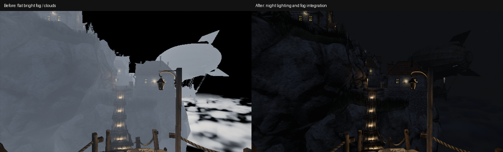

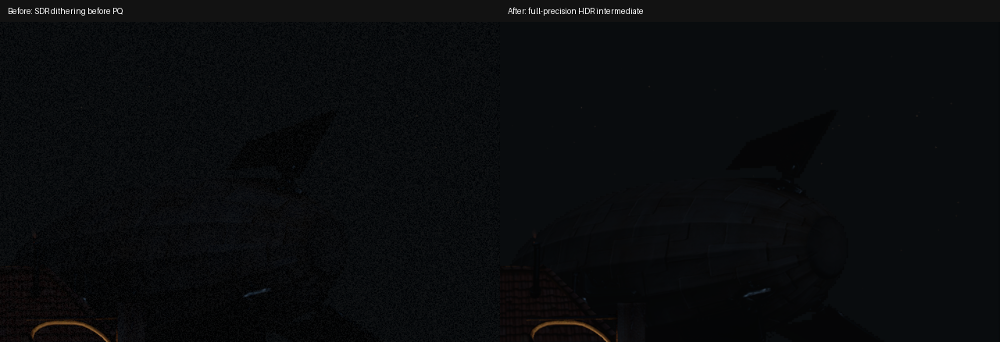

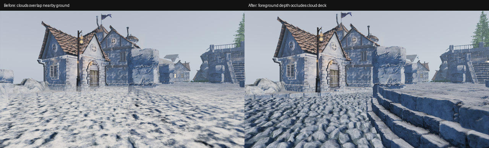

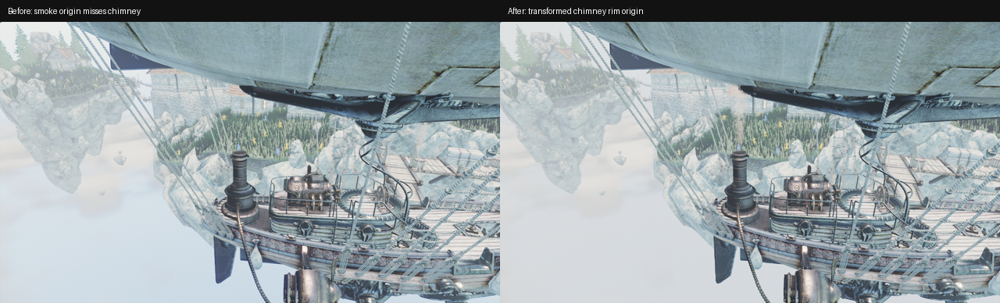

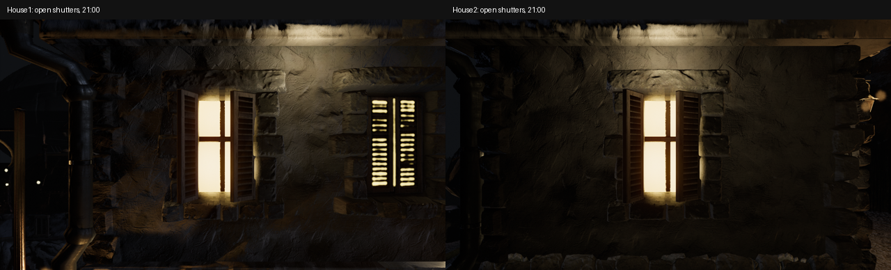

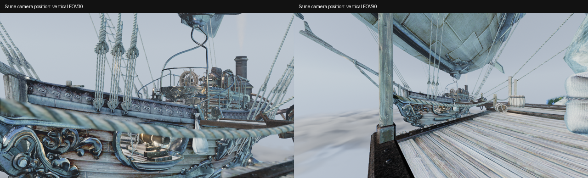

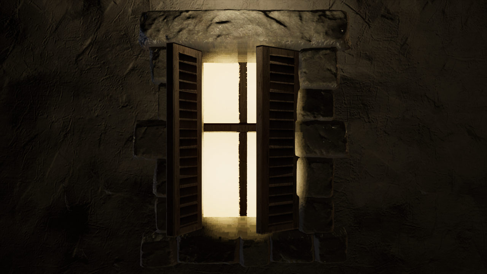

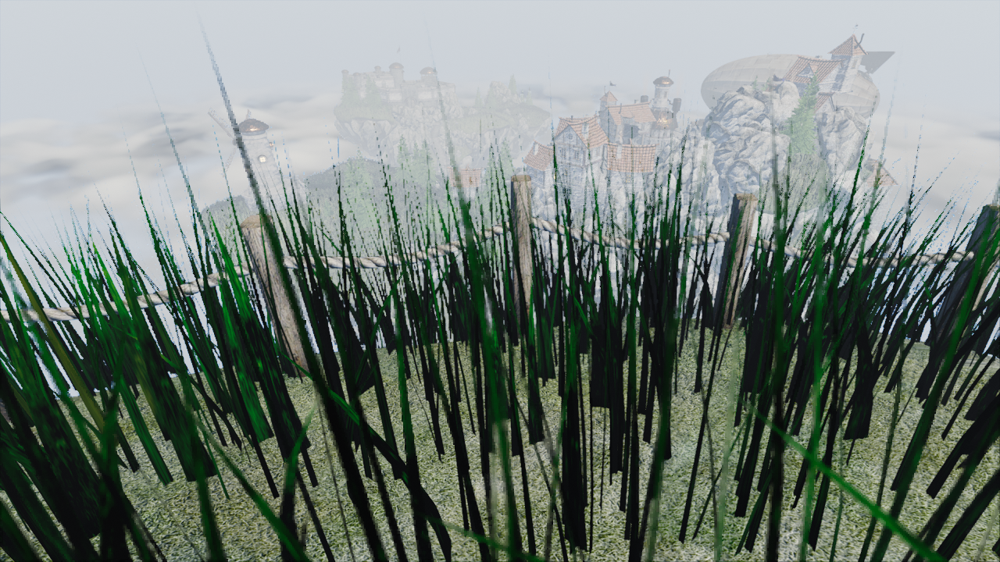

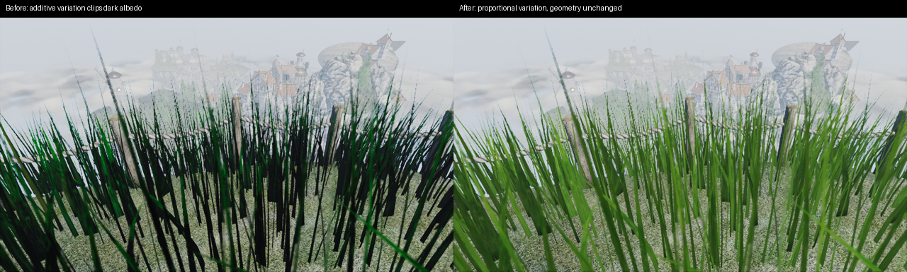

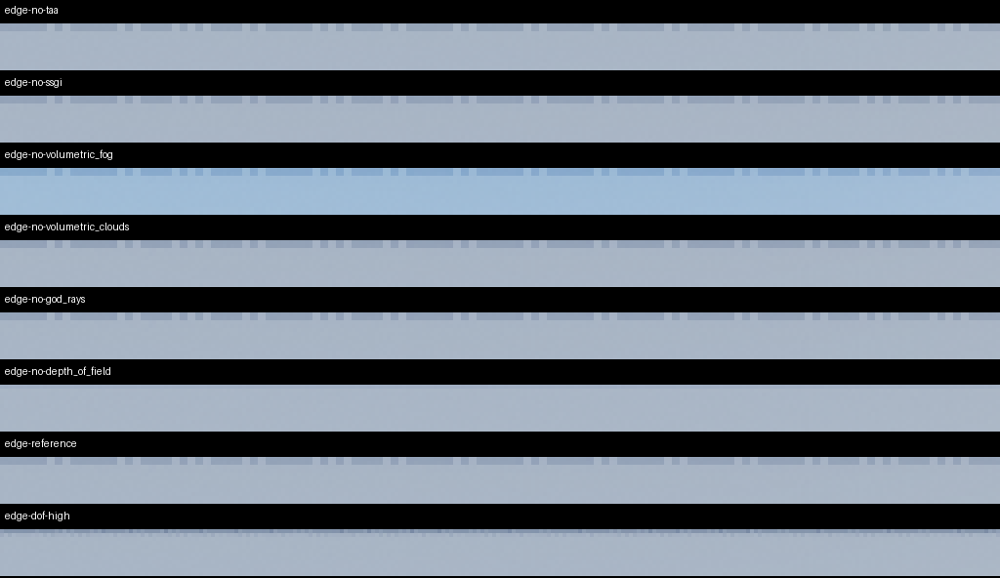

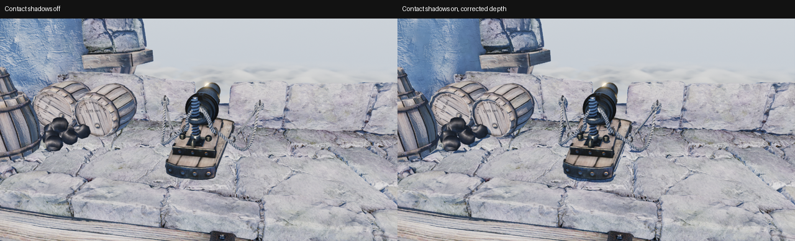

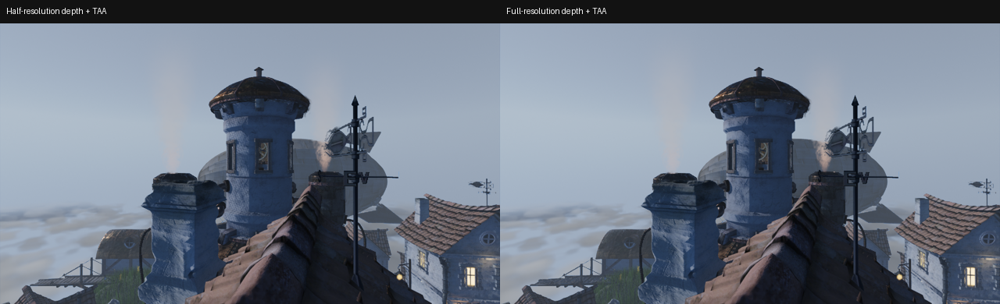

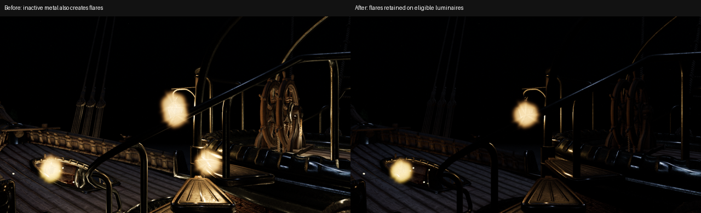

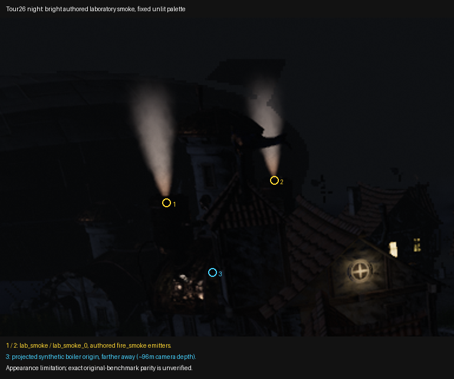

## Targeted follow-up views

The standard 135-case inventory samples all 26 authored tour starts and includes paired effect controls and quality/material variants. The checked-in [169-case manifest](visual-audit-cases.json) adds moving-camera, open-window, mill/torch, HDR, legacy-deck and FOV regressions used in this audit. Default-on bloom, ambient occlusion, TAA and depth of field now have explicit enable/disable controls, so a quality reduction is no longer used as a substitute for disabling a pass. Pair review must first confirm actual asset availability, visibility of the affected object, and effective settings; a requested high-resolution tier alone does not prove that tier was loaded.

The runner's current default views incorporate the successful supplemental cameras for material targets, boiler heat haze, sun-facing god rays, cloud decks, window bloom, contact/point shadows and the wind-debug flag. The 135 case names remain stable; each pair changes one setting. The checked-in historical manifests retain the exact earlier views instead of being rewritten to imply coverage that those runs did not have. Nineteen runner regressions cover orchestration, output validation, safe resume, exact camera/time metadata and these default-view contracts.

Seven additional cases are retained in `build/visual-audit/extra-views.json`. The first five captures completed successfully under `extra-views/`, with a contact sheet at `review/extra-views.png`; the two replacement open-window views completed under `open-windows/`, with `review/open-windows.png`. These are bounded observations, not original-engine parity:

| Case | Pose or timing | Review target |
|---|---|---|
| `window-halo-close-night` | Position `(-23.34942, 29.89840, 22.34291)`, yaw `-48.12304`, pitch `0`, FOV `30`, held hour `21`, 180 frames | The close image shows **closed shutters**. It must not close the historical open-window report, despite exposing the emission at useful scale. |
| `torch-refraction-close-on` / `off` | Position `(-128, -82, 19.5)`, yaw `143.31142`, pitch `-0.46605`, held hour `22`, 240 frames | The real fort torch emitter near `(-132.929, -78.327, 18.840)` appears against masonry. No hard rectangular edge is obvious in the reviewed pair. Establishing the extent and motion of heat distortion still requires the full-resolution pair or a sequence. |
| `mill-wings-close-90-frames` / `210-frames` | Position `(13.6, -102, 29)`, yaw `90.02118`, pitch `-0.40922`, held hour `12` | Blade orientation changes between 1.5 and 3.5 simulated seconds; no duplicate stationary wing set or detached hub is apparent in the reviewed frames. Two stills establish neither smooth motion nor original animation parity. |
| `house2-open-window-night` | Position `(-16.55995, 28.88356, 22.25873)`, yaw `-15.58437`, pitch `0`, FOV `45`, held hour `21`, 180 frames | Open shutters and the exposed pane are visible; no green/orange blocks appear. Surface on `house2.mesh`, `building_windows0_lod0`, at world center `(-12.70701, 27.80894, 22.25873)`. This is the bright window left of the earlier closed-window view. |
| `house1-open-window-night` | Position `(-15.51666, 18.35748, 25.45067)`, yaw `131.87696`, pitch `0`, FOV `45`, held hour `21`, 180 frames | Open shutters and the exposed pane are visible; no green/orange blocks appear. Surface on `house1.mesh`, `building_windows0_lod0`, at world center `(-18.18679, 21.33580, 25.45067)`. |

The two replacement window poses come from connected mesh components after welding positions at 0.0001 metres. The flat pane and two rotated shutter components are distinct; the camera is placed four metres along the transformed outward normal. Both surfaces resolve to `building_tessellation_windows`. The rendered frames confirm both open shutters and unobstructed panes. Smooth warm bloom is visible; the historical large colored blocks are not reproduced in these two views.

The main particle pair frames the boiler after four simulated seconds. The initial torch heat-haze pair has no useful coverage: this renderer attaches distortion to nearby smoke, while the torch has no smoke within the 25-metre capture cutoff. The supplemental boiler view looks through its plume from six metres away and produces visible distortion. God rays likewise require an on-screen sun; the supplemental 08:00 roof/sky views replace the downward tour camera. Actual `ruins_ground` and `fort_ground` closeups replace the weak generic-street ground-relief view. The bloom pair uses the exposed house2 pane at 30° FOV, which reveals VA-18 despite the smooth appearance in the earlier wider views.

Both 2K and 4K cases report 240 high-resolution texture uploads and four original uploads. The 2,361 fallback events include unsuccessful uncached lookup attempts, so they are not 2,361 missing distinct textures. These cases exercise upgraded textures and incomplete-tier fallback together. GPU instancing/skinning on/off pixel parity is expected; negligible differences for a material or screen-space feature require a visible target before claiming coverage. HDR geometry/artifact inspection uses raw PQ images and diagnostic previews; calibrated physical output, native Windows rendering, physical Android behavior and original-engine reference parity remain outside the local evidence.

## Contact-shadow flicker follow-up

The regression originates in our commit `38df114`: it added `screenSpaceContactShadows(!foliage_shadow_role)` to both regular and instanced scene renderables. Before that change, the scene's receiver opt-in was absent, so enabling the sun's option did not exercise this shader on those surfaces. `38df114` also changed structure-depth resolution but did not update Filament; the preceding Filament rebase was `313084e`. The source diff is retained in `build/visual-audit/shadow-flicker/regression-origin.diff`. This is an application regression exposed by our recent feature activation, not evidence of a newly degraded driver.

The user reported moving stippled patches over village rocks, walls and copper roofs after receiver opt-in. Reproduction uses the saved desktop workload: 1920×1080, visual-ultra base with custom overrides, 4×MSAA, requested 4K textures, foliage density 1.95, tessellation factor 1.8/distance 1.5, midday rain intensity 0.5, and contact shadows/TAA enabled. Original-texture fallback for unavailable 4K variants remains recorded in the capture metadata. Linux uses the Radeon AI PRO R9700; Vulkan is RADV Mesa 26.0.8 and OpenGL is radeonsi Mesa 26.0.0-devel. This is visual verification, not a new performance comparison.

Sixteen consecutive frames at pose `-50,-10,26,20,6`, vertical FOV 40°, beginning at accepted frame 120 reproduce the moving patches. Contact-shadows-off removes them; disabling soft shadows or AO in the earlier wide-view isolation does not. Disabling TAA stops the changing pattern but is not the fix. Filament's structure pass is unjittered while the original contact-ray projection used color-pass jitter. Correcting that projection alone still leaves self-intersections: nearest depth samples represent texel centers, and short rays can classify their own sloped receiver as an occluder. The approved shader change additionally moves the ray origin along the geometric normal by the receiver plane's half-depth-texel footprint. Contact-shadow distance, step count, receiver bits and TAA remain enabled.

For the same sixteen-frame village sequence, mean absolute RGB change per consecutive frame on the rock crop `(1390,860)–(1800,1070)` falls from **3.866 to 0.699** on the 0–255 scale; the contact-shadows-off control is **0.683**. On the wall crop `(950,565)–(1410,850)`, it falls from **3.291 to 0.743**, versus **0.684** with contact shadows off. These are measured image differences, not a universal acceptance threshold: rain, vegetation and lighting continue to animate. Inspected sequences show the large shifting stippled patches removed.

The new `contact_shadow_stability` GPU case renders the actual embedded lit material on a sloped plane with TAA and a nearby raised occluder. After warmup it checks sixteen consecutive frame deltas away from the occluder, then disables contact shadows and requires the actual shadow pixels to disappear. The receiver casts a shadow map because this Filament version only uploads contact uniforms with an active shadow map; the raised occluder does not cast a conventional shadow. An explicit negative control with the original `heaven_lit.filamat` fails at **4.2134** worst mean RGB delta; the fixed material gives **0.0000** and **320** detectable contact-shadow pixels on Vulkan. The fixed package was restored after that control. This closes the original synthetic-diff fixture's inability to catch temporal shader regressions.

The checked-in [shadow sequence manifest](../tests/visual/shadow_flicker.json) also covers a lower village view, moving islands, TAA-off, SSR-off, contact-shadows-off, and moving tower/cannon tour cameras. The 32-frame sequences preserve the same in-process temporal history, and each frame's files and metadata are validated. The Linux evidence lives under `build/visual-audit/shadow-flicker/`: `village-before/` retains the reproduced defect, `projection/` retains the insufficient projection-only experiment, `footprint/` is the controlled correction, and `validation-vulkan/`, `validation-controls/`, `validation-opengl/`, and `validation-hdr/` retain the broader scene checks. The corrected SSR-off/contact-off manifests pass in `validation-controls/`; their earlier conflicting-setting receipts in `validation-vulkan/` are excluded from the successful set. Early manifest receipts that rejected normalized data/cache paths or conflicting expected CLI settings remain failure evidence; they are not counted as successful gates. No Android build or physical-device acceptance is claimed for this change.

```bash
python3 scripts/visual_audit.py --manifest tests/visual/shadow_flicker.json \
  --data build/visual-audit/assets --output build/visual-audit/shadow-regression
```

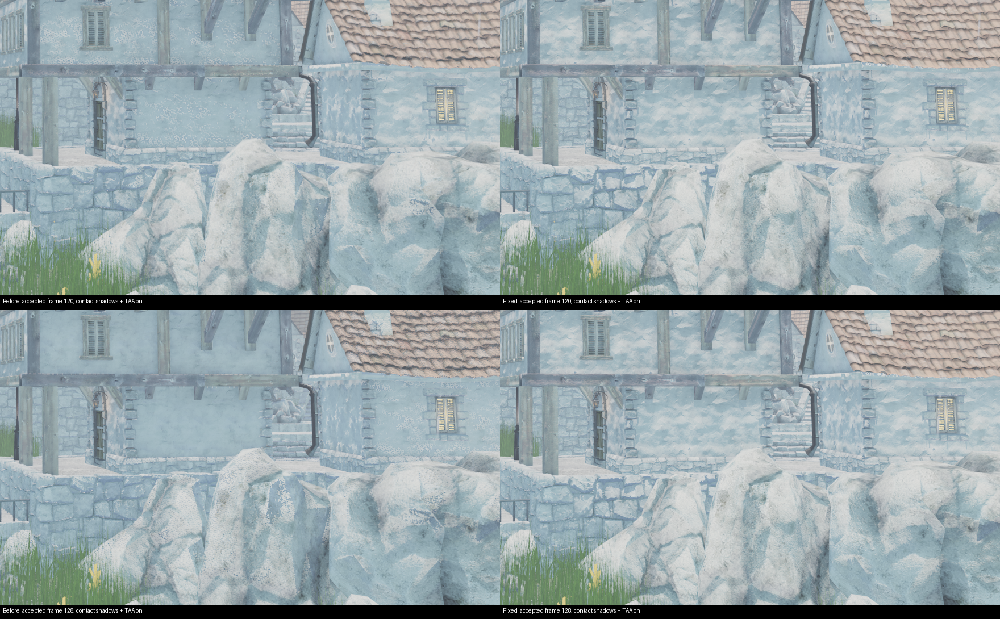

The Linux Docker candidate also passes actual GPU execution through its relocated AppImage launcher: static/moving-island Vulkan SDR, static Vulkan HDR and static OpenGL, 32 frames each. All 128 captured image payloads and the HDR PQ payloads are byte-identical to their native counterparts; every frame's metadata/configuration hash is verified. The 16 successful native sequences supply another 464 frames. These are 592 validated correction frames; failed manifests and the deliberately failing old-material regression are retained separately. Package/source hashes and Docker test/static-analysis results are recorded in [RELEASE_READINESS.md](RELEASE_READINESS.md#contact-shadow-temporal-regression).

## Residual cliff flicker and low-frame-rate investigation

The October 1 report identifies a smaller residual artifact on the cliff beside the blue flag, mansion, stairs and bench. The earlier `ba149be` correction removes the large village patches but does not fully handle smoothed vertex normals. Filament calls its interpolated vertex normal `shading_geometricNormal`; that vector need not describe the triangle stored in structure depth, especially on smooth or displaced geometry. A depth-texel bias derived from it can therefore remain too small and allow the contact ray to hit its own receiver.

The approved contact-shadow patch now computes the actual triangle plane from world-position derivatives in `computeShadingParams`, before alpha discard and divergent light/visibility branches. It orients that plane toward the viewer, handles degenerate derivatives with a vertex-normal fallback, and uses it only for the contact-ray origin offset. Material lighting normals, shadow distance/sample count, contact shadows, TAA, foliage and quality settings remain active.

The extended real GPU regression tests identical sloped geometry with either matching face normals or smooth front-facing vertex normals. With the preceding material, the face-normal test passes but the smooth-normal test fails at **4.5185** worst consecutive RGB delta. With the refinement, they measure **0.0000** and **0.0676**, respectively; the raised contact-only occluder still changes **320** and **314** pixels. This isolates a rendering error that exists independently of the scene's heavy workload.

The new [cliff manifest](../tests/visual/cliff_contact_shadow.json) holds camera `(15,-10,32)`, yaw 70°, pitch 5°, FOV 50°, at 1920×1080 with the user's custom workload and animated floating islands. `cliff-before/` and `cliff-after/` under `build/visual-audit/low-fps-flicker/` each contain five verified 32-frame sequences: fixed 60 Hz, fixed 15 Hz, normal wall-clock animation, contact-off and soft-shadows-off. Reviewed frames remove the small dark stippled patches on the sloped foreground rock. The `(1260,580)–(1330,650)` rock crop's mean/worst consecutive RGB delta changes from **0.802/1.076 to 0.725/0.801** at 60 Hz, **0.790/1.068 to 0.708/0.781** at 15 Hz, and **0.792/1.072 to 0.710/0.782** with wall-clock animation. These modest averages include ordinary texture sampling/dithering and are not a universal visual threshold. Scene motion prevents pixel equality between differently timed runs; the deliberately static GPU receiver provides the stronger isolation.

```bash
python3 scripts/visual_audit.py --manifest tests/visual/cliff_contact_shadow.json \
  --width 1920 --height 1080 --data build/visual-audit/assets \
  --output build/visual-audit/cliff-regression

./scripts/run.sh --config config.json --camera-pose 15,-10,32,70,5 \
  --camera-fov 50 --profile build/cliff-profile.json --profile-seconds 65
```

The fixed-rate captures change simulation steps, not actual rendering throughput. Real-time captures still synchronize for image readback. Performance comparisons therefore use the separate `--profile` action with no screenshot readback or overlay, a two-second warmup and at least 60 measured seconds. Before/after executables have identical profiling instrumentation; the baseline retains `ba149be`'s material packages. Per-run configuration, executable hash, exit status, timings and one-second hardware samples are retained in `low-fps-flicker/profiles/`.

The first six timing runs under `low-fps-flicker/profiles/` are **invalid for performance conclusions**: an older interactive `heaven_benchmark` process (PID 1877870, executable SHA-256 `0d98fcfc901e58c902777b73e6e10db627b5437d2ff084cf659a5cb1298356ee`, matching the preserved pre-fix executable) was still running. It competed for GPU time throughout that batch. The original measurements and explicit `INVALIDATED.json` are preserved. Isolated replacement runs use `profiles-isolated/`; the older application is temporarily suspended and resumed in a `finally` handler, and no Docker build, static analysis or second active renderer overlaps the measurements. `isolated-process-receipt.json` records that control. Capture images remain visual evidence, with no throughput interpretation.

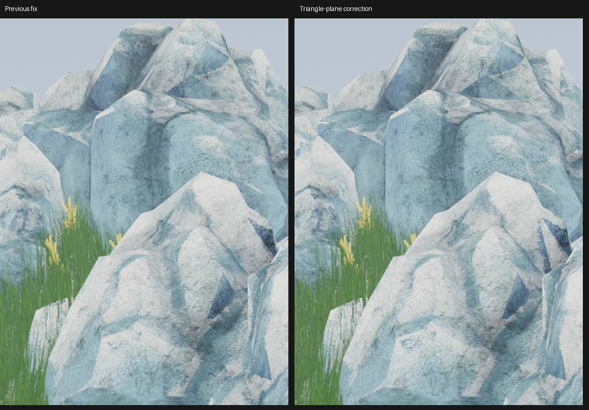

The final native harness passes **36 cases, two original-reference parity skips and zero failures** on Vulkan SDR, Vulkan HDR and OpenGL. The smooth-normal receiver delta is **0.0676** on Vulkan and **0.0000** on OpenGL, with **314/308** contact-only shadow pixels retained. Actual scene checks add 32-frame fixed-15-Hz and wall-clock cliff sequences on OpenGL and Vulkan HDR, plus the earlier static/moving-island village views on Vulkan. These supply **352 frames from the corrected native executable**, alongside **160 baseline frames**. Every image and sidecar hash is rechecked in `native-sequence-verification.json`; `material-gpu-validation.json` verifies all 33 embedded packages and terminal GPU outcomes. HDR previews are diagnostic mappings of captured PQ output, not physical display measurements. No further API-specific flicker was found in the inspected cliff/village sequences.

The corrected isolated results are:

| Same-camera run | Average FPS | Median completed GPU time | Measured seconds |
|---|---:|---:|---:|
| before | 20.34 | 48.47 ms | 63.03 |
| after | 20.40 | 48.34 ms | 62.99 |
| before-repeat | 20.39 | 48.35 ms | 63.02 |
| after-repeat | 20.40 | 48.34 ms | 63.04 |
| no-foliage | 53.67 | 18.28 ms | 63.00 |
| no-soft-shadows | 38.92 | 25.30 ms | 63.00 |

The full-quality paired configurations are equal after excluding only the per-run cache path; the corrected profiler also confirms a 1×1 render scale with adaptive resolution disabled. The isolated baseline measures **20.34–20.39 FPS**, and the corrected shader **20.40 FPS** in both repeats. Median GPU utilization is **100%** with about **48 ms** of GPU work and **1 ms** of CPU render submission. Foliage-off (**53.67 FPS**) and soft-shadows-off (**38.92 FPS**) identify substantial, interacting GPU costs; they are diagnostic controls, and their savings cannot be added independently. No feature was disabled as the fix. This view is GPU-limited and the correction has no demonstrated meaningful throughput cost. The user's roughly 15 FPS is a different framing/live workload, not reproduced as exactly 15 by this fixed camera. Low frame rate makes temporal noise more conspicuous, but the deliberately tiny GPU fixture proves the receiver self-intersection independently of the heavy scene.

The Docker-built AppImage completes four further 32-frame sequences through its extracted `AppRun`: fixed-15-Hz and wall-clock Vulkan SDR, fixed-15-Hz Vulkan HDR and fixed-15-Hz OpenGL. All **128 images and sidecars** pass verification. The fixed-rate images differ sparsely from native output: worst whole-frame mean absolute RGB8 differences are **0.000031/0.001274/0.000009** for Vulkan SDR/HDR preview/OpenGL, with peak channel differences of **6/28/2**. At most **4/492/1 pixels per 2,073,600-pixel frame** differ by more than one level. In the cliff crop `(1060,0)–(1560,700)`, worst mean differences are **0.000040/0.000025/0.000009**. The raw HDR captures also differ in bytes; they remain finite, bounded PQ captures, not a claim of exact native/package or physical-display parity. Inspection of the package frames and amplified difference image found no renewed cliff-shadow patches. `package-sequence-verification.json`, `package-pixel-comparison.json` and `package-cliff-comparison.json` retain those limits; the initial strict byte-identity probe remains a failed comparison rather than being relabeled as equality.

The final AppImage's separate isolated profile measures **20.33 FPS over 63.01 seconds** after warmup, with no capture readback, matching the camera, configuration and actual 1920×1080 render scale of the native runs. The older interactive process is suspended for package validation and resumed afterward; `package-process-receipt.json` records it. The final tally for this follow-up is **480 validated frames from corrected executables**, plus **160 baseline frames**. The Docker export independently verifies all **669 source files**, all artifact hashes and all **41 packaged ELF files**. [RELEASE_READINESS.md](RELEASE_READINESS.md#residual-cliff-flicker-follow-up) records the candidate hashes and platform boundaries. Only post-build evidence notes differ from the frozen source archive.

## Cottage ledge flicker follow-up

**Superseded correction:** the measurements below describe `ec8b818`. Its receiver-plane rejection later caused triangular light leaks on rounded stone, and its grazing test incorrectly treated geometric self-shadowing as an error. The [rounded-stone follow-up](#rounded-stone-contact-shadow-regression) replaces that algorithm and records current acceptance. The earlier counts remain historical evidence, not validation of the current shader.

The October 1 screenshots of the two cottages beside the airship revealed a case outside the previous cliff fixture: thin, changing contact-shadow lines along the taller cottage's stone ledges. The actual scene reproduces this at camera `(-9,11,28)`, yaw 113°, pitch -8°, FOV 50°, 1920×1080, using the same custom visual-ultra workload. Captures with contact shadows off remove the line; tessellation off leaves it unchanged, and TAA off leaves the false shadow pattern but makes it largely static. Disabling conventional soft shadows masks the defect under the darker conventional shadow, so that control alone is not evidence of a soft-shadow implementation fault.

A smooth or normal-mapped lighting normal can admit sunlight even when the contact ray points below the actual triangle plane. The earlier half-texel origin lift cannot prevent a longer ray from crossing that same plane. The approved Filament contact-shadow fix now rejects a sampled depth that belongs to the receiving triangle, using an affine native-texture depth plane evaluated at the sampled texel center. A small relative allowance handles FP32 roundoff; separate occluders remain eligible, and the ray distance, sample count, original offset and quality settings remain unchanged. This addresses another case of the contact receiver regression introduced by our `38df114` change; it does not require a driver switch or reduced graphics quality.

The expanded GPU fixture places a separate shadow-map caster behind a grazing receiver so conventional self-shadowing cannot hide the contact error. With `b0b650a`'s material packages, all **4,096** sampled receiver pixels falsely darken by more than eight red-channel levels when contact shadows are enabled. With the correction, **zero** do. The earlier flat/smooth sloped receivers still retain the raised contact-only occluder's shadow. The final fixture covers perspective, off-axis and orthographic cameras on Vulkan and OpenGL; each API's full harness, plus the HDR startup path, reports **36 passes, two original-reference parity skips and zero failures**. These synthetic receivers establish self-intersection behavior independently of frame rate, without claiming original-engine visual parity.

In the actual scene's ledge crop `(350,463)–(850,490)`, mean/worst consecutive RGB change falls from **3.055/5.052** to **0.563/0.635**; the contact-off diagnostic measures **0.543/0.611**. The comparison uses 24 baseline and 32 corrected frames after 120 warmup frames. Ordinary texture sampling, tone-map dithering and scene animation remain in these measurements; they are not a universal zero-flicker threshold. All captured settings and image hashes are retained under `build/visual-audit/ledge-flicker/`. The previous patch's specific cliff improvement remains valid, but did not cover this grazing receiver case.

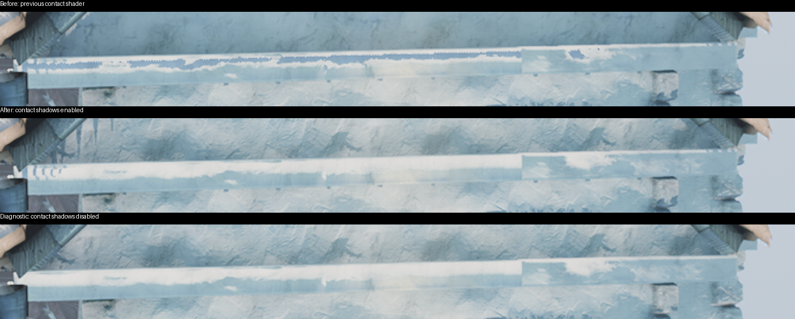

Reproduce with `python3 scripts/visual_audit.py --manifest tests/visual/ledge_contact_shadow.json --data build/visual-audit/assets --width 1920 --height 1080 --output build/visual-audit/ledge-regression`. The manifest includes fixed and wall-clock sequences, moving islands at 15 Hz simulation steps, a contact-off control, MSAA off and two additional camera elevations. Capture readback affects throughput; its fixed 15 Hz simulation setting does not cap the GPU at 15 FPS. Android builds remain deferred to physical-device testing.

Final native checks contain **416 verified frames**: seven 32-frame cottage sequences on Vulkan, two each on OpenGL and Vulkan HDR, plus the previous cliff and village regression views. All processes exit successfully and image/configuration/metadata hashes are independently rechecked in `ledge-flicker/native-sequence-verification.json`. The 23 visual-runner tests and the focused Docker Clang-Tidy check pass; all 33 embedded material packages match their binary inputs.

An isolated no-readback profile at the cottage camera measures **9.249 FPS before and 9.263 FPS after**, over **63.03/63.05 measured seconds** after warmup. Median whole-frame GPU time is **106.67/106.79 ms**, with **1.62/1.70 ms** CPU submission. Both runs use identical rendering configuration, GPU/driver, full 1920×1080 render scale and normal wall-clock simulation; only their separate user-cache paths differ. No second renderer or build overlaps them. This close cottage view is heavier than the earlier cliff camera, so its FPS must not be compared directly to that camera's 20 FPS result. The change removes the false contact hits without a material performance change; it is not an optimization of the foliage/soft-shadow workload. Receipts, hardware samples and reports are under `ledge-flicker/profiles/`.

The shared Docker release pipeline passes all ten top-level tests, one standalone packer test, three renderer host/CLI suites and full Clang-Tidy over 2 extraction plus 323 renderer/test/smoke sources. The headless container skips graphical execution; the separate real GPU harness above supplies that evidence. The first Docker attempt failed because the updated bootstrap pins omitted the quoting required by its fixture editor; restoring the existing format passes all 18 bootstrap regressions and the full rerun. The failed log is retained as `docker-release-attempt1.log`.

The final extracted AppImage adds **128 verified frames** through its bundled `AppRun`: fixed-15-Hz and wall-clock Vulkan sequences, and fixed-15-Hz HDR/OpenGL sequences. Of the 96 comparable fixed-step previews, 85 match the native images exactly; the remainder differ by a single channel value of one in one pixel per frame. Raw PQ files are finite and bounded but only 23 of 32 match exactly; this is not a claim of physical HDR-display or original-engine parity. Image/configuration/metadata hashes, runtime receipts and full-frame pixel comparisons are retained under `ledge-flicker/packaged-*` and the package verification JSON files. The corrected native/package total is **544 validated scene frames**. All 671 exported source files and artifact hashes verify, and all 41 bundled ELF files pass stack/dependency/ABI checks (maximum required glibc 2.38, no unconditional Vulkan-loader dependency). Only the subsequent evidence notes in this report and `RELEASE_READINESS.md` differ from the frozen source archive.

## Rounded-stone contact-shadow regression

The subsequent October 1 screenshot shows bright triangles and criss-cross bands around stone bevels. The laboratory foundation reproduces it at `(-28,1,23)`, yaw 60°, pitch 0°, FOV 50°, 1920×1080. Exact-camera comparisons isolate it to our `ec8b818` contact receiver-plane rejection: the preceding `b0b650a` packages do not show the large pattern, contact-off removes it, and tessellation-off leaves it visible. The soft-shadow-off control masks it with conventional self-shadowing and does not identify a soft-shadow implementation defect. This is a new regression in our fix, not established broken mesh topology or a consequence of the heavy scene's frame rate.

Rejecting a hit on the receiving triangle while accepting neighboring noncoplanar triangles produces discontinuous lighting on curved meshes. The prior half-depth-texel normal offset also depends on individual triangle orientation. The replacement removes both mechanisms, retains the unjittered projection, and tests reconstructed bilinear depth together with nearest depth. Both must intersect the existing ray slab. Continuous surfaces no longer behave like depth-texel staircases, and separated silhouettes are not treated as one interpolated sheet. The actual triangle normal is retained only to identify an immediate receiver hit: a ray entering that surface is already occluded at t=0, and its first dithered step must not skip past that intersection. This additional check removes the smaller stippled patch still visible in the intermediate reconstruction on a steep stone bevel. Contact shadows, geometric self-shadowing, ray length, sample count and graphics settings remain enabled and unchanged. The technique and implementation details are in [the Filament patch notes](../patches/filament/README.md).

The test's earlier grazing assumption was wrong: if a smooth lighting normal admits sunlight from below the actual geometry, a ray into that geometry is legitimately occluded. A flat plane that becomes completely illuminated after rejection is not proof of a correct contact-shadow implementation. The expanded GPU fixture adds convex, twisted patches with neighboring noncoplanar triangles and requires consistent back-lit occlusion while front-lit surfaces remain free of acne. With the defective packages, its curved grazing crop shadows only 1,995–2,320 of 4,096 pixels and has worst consecutive RGB changes of 1.42–34.02 across the three camera projections. A separate raised contact-only occluder still checks that real shadows remain present.

An intermediate reconstruction exposed a separate texture-gather precision issue: sampling at the ray UV can choose a different 2×2 footprint from the shader's FP32 interpolation weights near texel boundaries. Increasing the depth allowance did not remove the isolated off-axis failure. Sampling at the computed footprint center resolves it; the final allowance stays at `2e-6`. The four-texel ESSL 300 fallback clamps integer coordinates explicitly. Failed intermediate GPU logs and actual fixture captures are retained under `build/visual-audit/stone-triangles/`; thresholds were not relaxed to hide the failure.

The repeatable scene manifest is `tests/visual/stone_contact_shadow.json`: close and wide wall views, contact/tessellation/MSAA controls, fixed 15 Hz simulation with moving islands, wall-clock animation, and the prior cottage/cliff cameras. Fixed simulation time does not cap rendering FPS. Captures and performance profiles are separate; profiling has no readback or concurrent build/renderer workload. Original-engine image parity and physical HDR-display acceptance remain outside these checks. Android builds are deferred to physical-device testing.

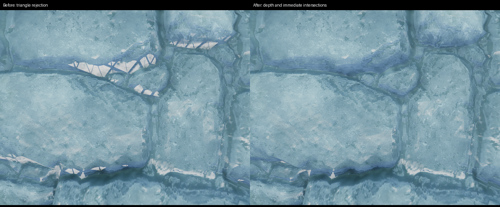


The steep-surface counterexample is independently checked against the exact material packages from the intermediate Docker source archive. Without immediate-hit handling, only **2,679 / 3,557 / 0** of the 4,096 receiver pixels are shadowed for perspective/off-axis/orthographic cameras, with worst consecutive RGB changes **3.97 / 3.58 / 1.28**. With immediate-hit handling, all **4,096** are shadowed and the sampled temporal change is **zero** for every projection on Vulkan and OpenGL. Front-lit flat/curved fixtures retain zero false receiver pixels, and separate raised occluders retain contact shadows. The final fixture covers **18 geometry/light/projection combinations**; neither its zero-acne assertion nor its temporal threshold was relaxed. `depth-only-fixture.log` preserves the failing intermediate material test.

The final isolated profile pair at the wall camera measures **9.436 / 9.431 FPS** over **63.06 / 62.99 measured seconds** after warmup. Median whole-frame GPU time is **104.51 / 104.57 ms**, with **1.72 / 1.69 ms** CPU submission. Both use the Radeon AI PRO R9700, RADV 26.0.8-1ubuntu0.3, full 1920×1080 output, 4× MSAA and the same custom high-load settings; configuration JSON differs only in the user-cache path. No build or second renderer overlaps either measurement. There is no demonstrated meaningful throughput change. The tiny synthetic regression reproduces the rendering defect independently of the heavy scene's low FPS. Receipts and GPU telemetry are in `stone-triangles/profiles/` and `profile-comparison.json`; `depth-only-profiles/` belongs to the superseded intermediate shader.

The final Vulkan crops have mean/worst consecutive RGB8 differences of **0.482/0.493** on the stone wall, **0.646/0.729** on the cottage ledge, and **0.760/0.868** on the cliff. The wall's contact-off control measures **0.477/0.486**. These are 32-frame sequences after 120 warmup frames; normal texture/edge sampling, tone-map dithering and animation remain. They establish removal of the reproduced patches, not universal zero temporal variation. `temporal-crops.json` records the crop coordinates and measurements. The final GPU harness reports **36 passes, two original-reference parity skips and zero failures** on Vulkan, HDR startup and OpenGL; all 33 embedded material packages match their binary inputs.

The final native scene sweep contains **544 verified frames**: nine 32-frame Vulkan cases and four each on OpenGL and HDR. All processes exit successfully, and an independent pass rechecks every image, metadata/configuration sidecar and raw PQ hash. The inspected close/wide and moving-island wall sequences no longer show the reported bright bands or the smaller stippled bevel; the previous cottage and cliff cases remain stable. `native-sequence-verification.json` and `sequence-receipt.json` retain the exact binaries, settings and run results. The 23 visual-runner tests, 18 bootstrap tests and focused Docker Clang-Tidy check pass. The intermediate `depth-only-*` runs and package are preserved as superseded diagnostic evidence.

The final shared Docker pipeline passes all ten extraction/bootstrap suites, the standalone packer suite, three renderer host/CLI suites, and complete Clang-Tidy over **2 + 323** sources. Its headless GPU skip is covered by the separate real GPU runs above. The extracted AppImage adds **128 verified frames**, bringing final native/package coverage to **672 frames**. All comparable package previews differ from native output by at most one RGB8 channel level; worst whole-frame mean difference is **0.000001286**. Raw PQ captures are finite and bounded, with 0 of 32 byte-identical to native; physical HDR-display parity is not claimed. All **673 exported source files**, artifact hashes and **41 packaged ELF files** pass independent verification; maximum required glibc is 2.38, with no executable stack or unconditional Vulkan-loader dependency. Only the subsequent evidence paragraphs in this report and `RELEASE_READINESS.md` differ from the frozen source archive. Package receipts, source/ELF reports and pixel comparisons are retained under `stone-triangles/`.

## Roof-tile contact-shadow mismatch

**October 3, 2026 — original VA-23 investigation; the mesh-filtered correction below supersedes the noon result.** The user's two roof closeups show abruptly dark polygonal patches rather than a smooth transition between lit and shadowed tile surfaces. Actual-application captures reproduce this on `house2.mesh`, surface `building_roof_lod0`, material `building_tessellation_roof`. The preceding wall fix did not establish visual acceptance for this roof. This is a release blocker, not a successful fix report.

The checked-in [roof manifest](../tests/visual/roof_contact_shadow.json) uses two cameras: `(-9.8,24.3,27.5)`, yaw 90°, pitch −40°, and `(-12,22,28)`, yaw 75°, pitch −25°, both with 50° FOV. Captures use 1920×1080, noon lighting, the custom high-load visual settings, 4K textures, 4× MSAA, contact-shadow level 2, tessellation factor 1.8 and distance multiplier 1.5. Each sequence has 120 warmup frames and 32 captured frames at a fixed 60 Hz simulation step; that step is not a measured rendering frame rate. Controls change only the named setting at the first camera.

```bash
python3 scripts/visual_audit.py \
  --manifest tests/visual/roof_contact_shadow.json \
  --data build/visual-audit/assets --width 1920 --height 1080 \
  --output build/visual-audit/roof-shadows/reproduction
```

Use a complete local asset pack in place of the audit data path. The runner isolates configuration/cache directories and records executable, asset, driver and capture hashes. This manifest is a reproducer for an open defect; a successful capture process is not a visual pass.

| Controlled comparison | Observed result |
|---|---|
| Production `19ff05e`, both roof angles | Large dark polygonal patches reproduce. |
| Contact shadows off | The reported large patches disappear. This is diagnostic, not the shipped configuration. |
| Tessellation off | The patches disappear along with geometric tile displacement. |
| Soft shadows off | The patches remain; disabling that filter does not isolate the cause. |
| Original texture tier | Patches remain; generated 4K textures are not a sufficient explanation. |
| Retained material before the immediate-hit check (`7ba57a98b` vendor tree) | Patches remain under ordinary depth marching. Removing only the latest t=0 check is insufficient. |
| Temporary immediate-hit-only shader, depth marching bypassed | Patches also reproduce from displaced triangle orientation alone. This diagnostic shader is not retained. |

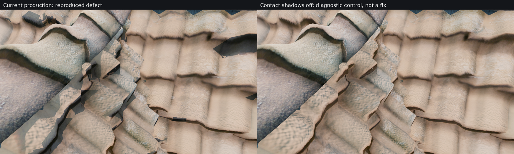

A CPU diagnostic reconstructs the material's final displacement from cached neutral vertices, the sampled height map, authored UV transform, displacement scale/fade and instance transform. Projecting faces with negative geometric-normal dot sun-direction overlays the locations of the dark patches. This supports a mismatch between the height-displaced mesh's geometric horizon and its smooth/normal-mapped lighting. The projection is an approximate diagnostic, not an exact GPU-depth comparison or proof of original-engine parity. Inspecting the neutral cache alone misses the displaced face orientation. No missing indices or mesh holes have been established, and these captures do not implicate low FPS or a particular driver defect.

This class of abrupt boundary is commonly called a shadow terminator: smooth shading can admit light that the actual triangle geometry blocks. [MoonRay's documentation](https://docs.openmoonray.org/user-reference/how-to-guides/shadow-terminators/) describes the geometry/normal mismatch and the tradeoffs of smoothing it. [Hanika's Ray Tracing Gems II chapter](https://jo.dreggn.org/home/2021_terminator.pdf) discusses geometric remedies and their limits, including normal-map detail. Neither reference supplies a validated drop-in correction for this screen-space implementation. The current synthetic test's fully shadowed back-lit receiver establishes consistent geometric occlusion; it does not prove that the smoothly textured roof looks correct.

Three candidate approaches were rejected. Raising the roof's uniform subdivision ceiling produced broader dark bands. Experimental height-error refinement increased the selected roof surface to about 1.61 million triangles and still left dark strips/slivers. A contact-ray rule that ignored the initial receiver intersection until the ray exited left roof outlines and brought bright bevel seams back to the stone wall. That run also retained the experimental roof-subdivision object, so it is not a clean baseline-topology comparison; the separate stone-wall regression still rejects the candidate. Its five 16-frame scene sequences completed normally; visual review rejected the result despite successful execution. None of these topology, cache or shader changes is in production.

Evidence is retained under `build/visual-audit/roof-shadows/`: `close/`, `isolate/`, `depth-only/` and `origin-only/` establish the comparisons; `density4/`, `adaptive/` and `interval/` retain rejected experiments. `project_horizon.py` and `geometric-horizon.png` preserve the approximate orientation diagnostic. `final-vulkan/` and `final-opengl/` record the restored production build. The first restoration retained a stale subdivision object because the copied source timestamp was older than the experimental object; `confirmed*` and the first `restored-*` receipts are invalidated in `invalidated-restoration.json`. A forced source/shader rebuild and new capture directories replace that evidence. The final shader and scene-loader sources match their pre-investigation versions, all 33 material packages are byte-identical to the saved originals, and the native renderer/smoke executables were rebuilt after restoration. No performance improvement, zero-flicker guarantee or full original-Heaven parity is claimed. Android builds remain deferred.

Final restoration checks independently verify **192 captured frames** and all image/configuration/metadata hashes: five 32-frame Vulkan cases and the 32-frame first-roof OpenGL sequence. Both APIs reproduce the roof defect. The Vulkan and OpenGL GPU harnesses each report **36 passes, two original-reference parity skips and zero failures**; these checks establish restoration of existing test behavior, not roof visual acceptance. The native scene again reports **19,355,485 tessellated triangles**, matching the starting build, versus **20,378,350** in the invalidated stale-object captures. Receipts are `final-capture-verification.json`, `final-source-restoration.json` and `final-gpu-receipt.json`. No new release package was built.

A future correction must improve both roof angles while retaining the separate contact-only occluder, the rounded stone wall, cottage ledges and cliff frame sequences. Disabling contact shadows, reducing displacement or merely relaxing the synthetic assertions would not establish that outcome.

## Filament upstream and weekly regression audit

**October 3, 2026 — VA-23 follow-up.** The regression trigger is our September 30 scene-receiver activation, `38df114`, rather than an identified new contact-shadow implementation in the Filament rebase. Removing only its two `screenSpaceContactShadows(!foliage_shadow_role)` calls removes the roof polygons while retaining the current library, materials, geometry, TAA and light settings. This was a temporary diagnostic reversal, not a shipped feature-disable fix. Both calls were restored afterward.

GitHub's live [latest-release endpoint](https://api.github.com/repos/google/filament/releases/latest) identifies [v1.77.2](https://github.com/google/filament/releases/tag/v1.77.2), published September 28 at 20:59:51 UTC, as the latest stable release. That is already the pinned public base, `1da46b0a2940db9b1286ec3a8910954c191c010c`. A fresh fetch also checked upstream `main` at [`70d2da5e9b7014e1a4207d737aa8dc41b59880a2`](https://github.com/google/filament/commit/70d2da5e9b7014e1a4207d737aa8dc41b59880a2), dated October 2. No newer contact-shadow fix was found there: all shader sources, shadow-map management, render-pass code and View implementation are unchanged relative to the release. The post-process source difference only adjusts two material-pointer const qualifications. Newer unrelated lifetime, upload, API and transform-management changes are not evidence of a shadow correction; the reviewed stable pin remains unchanged.

The complete `screenSpaceContactShadow` function is byte-identical in the retained pre-rebase vendor `b3cedc553`, v1.77.2 and fetched upstream `main`: 1,374 bytes, SHA-256 `e12c86e1c6e1663bee666d25b4f8b22f9d666f3654231aff006025421c2e9b93`. The full `surface_shadowing.fs` file has only a directional-variant guard difference between the pre-rebase version and v1.77.2, outside that function, and is identical between v1.77.2 and current `main`. This is source-level evidence about the contact path, not a claim that every part of those Filament versions renders identically.

| Repository boundary | Relevant change and evidence |
|---|---|
| Before this week's work (`c399fbc`) | Scene renderables retain Filament's default contact-receiver opt-out, even though the sun's contact-shadow option can be enabled. Roof lit material source and mesh-upload code are unchanged between this revision and the current production tree. |
| `313084e`, September 30, 17:51 CEST | Rebase to Filament v1.77.2; regenerate material packages for version 77. The upstream contact function did not change relative to the retained pre-rebase vendor. No scene-receiver opt-in was added here. |
| `38df114`, September 30, 23:12 CEST | Enable contact receivers for ordinary and instanced scene geometry and require full-resolution structure depth. Reversing only the two receiver calls eliminates the current roof patches. |
| `ba149be` / `b0b650a` / `ec8b818`, October 1 | Local projection, origin-bias and receiver-plane corrections addressed flicker; the last plane-rejection approach separately introduced the bright stone triangulation already documented above. |
| `19ff05e`, October 1 | Depth reconstruction and immediate receiver-hit handling corrected the inspected stone case. The roof polygons also occur with the rebase-era shader, so this last patch is not their sole origin. |

The weekly geometry review compares `c399fbc..ea076d3`: static mesh-loader and CPU tessellation edits add bounds/overflow checks or equivalent type/namespace cleanups, and the scene-loader's functional change concerns boiler smoke placement. The roof displacement material, UV transform/scale policy, mesh upload and material-instance routing are unchanged. Material database changes control synthetic emission-light eligibility. Texture uploads add a fallback for unsupported compressed formats; the earlier original-texture control also reproduces the roof patches. No new roof-topology or displacement-policy change was found in this interval. These are reviewed source changes, not a complete executable bisect of every historical commit.

The GPU comparisons use the two checked-in roof poses and the stone-wall pose, 1920×1080, 120 warmup frames and 16 consecutive frames per case. The historical material control replaces only `heaven_lit.filamat` and `heaven_lit_colored_penumbra.filamat` with their exact `313084e` bytes; their `.mat` sources are identical to current source, and they cover the opaque roof/wall path. All other material packages and application behavior remain current. This separates the unmodified upstream contact shader from our later shader fixes without mixing incompatible package versions or rebuilding the whole scene with old application behavior.

| GPU control | Result |
|---|---|
| Current materials, receiver activation reversed | Roof polygons disappear at both roof angles. |
| Rebase-era opaque materials, receivers active | The dark polygons remain, with additional dithered self-shadow artifacts. |
| Rebase-era opaque materials, receivers active, TAA off | Dark polygons remain. TAA is not necessary for this roof defect. |
| Restored current production sources and materials | Roof defect remains; no diagnostic disable or old material is retained. |

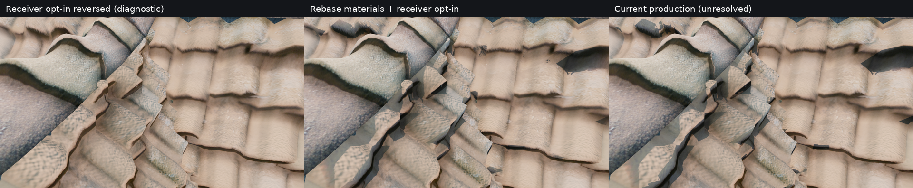

Upstream [discussion #7691](https://github.com/google/filament/discussions/7691) reported contact-shadow flicker on sloped surfaces in 2024, later associating that reproduction with TAA and Linux/OpenGL. It supplies related historical evidence, not proof that its exact cause matches these roof polygons, and it does not identify a merged correction in the source checked here. Our no-TAA roof control still shows the polygons.

Evidence is retained under `build/visual-audit/upstream-shadow-audit/`: `latest-release.json`, `upstream-main-history.txt`, `upstream-contact-identities.json`, weekly source diffs, material hashes, per-case capture receipts and the restored-build log. No Filament source patch or upstream pin changed; no development-branch rebase, new release package or Android build was performed. The unresolved roof appearance still needs a correction to contact visibility that agrees with displaced smooth shading while preserving separate occluders and the stone/cliff regressions.

The completed follow-up verifies **160 real GPU frames** and every image/configuration/metadata hash: 48 with receiver opt-in reversed, 48 with rebase-era opaque materials, 16 for the no-TAA control, and 48 after restoration. The final executable SHA-256 is `69952c109e54ebb3c2f351e8934ff93f75a59452b1d90ec3a60eb48e173084ef`, byte-identical to the starting production binary; all 33 material packages and the scene-builder source also match their saved originals. Both final Vulkan and OpenGL harnesses report **36 passes, two original-reference parity skips and zero failures**. `verification.json` and `final-gpu-receipt.json` record these checks. They validate the historical comparison and restoration, not a fix for VA-23.

## Mesh-filtered displacement correction

The follow-up isolates an additional cause of VA-23: the vertex shader sampled height mip zero near the camera even where adjacent mesh vertices spanned many height texels. Unresolved texture detail therefore became false geometric slopes and shadow-casting folds. Enabling contact receivers in `38df114` exposed those slopes. The Filament rebase did not introduce a different contact function; the reviewed v1.77.2 vendor tree and its existing depth-reconstruction patch remain unchanged.

The correction computes a height-sampling footprint from incident UV edges once during static or skinned mesh upload. Material vertices transform that footprint by the authored UV scale and actual height texture dimensions, then select the coarser of the mesh footprint and the existing distance-dependent mip. The authored displacement amplitude and distance fade are unchanged. Color, shadow and shared-depth materials use the same rule. Normal maps retain the fine surface detail; no extra fragment sampling, shadow-ray offset, contact-receiver exclusion, triangle reduction or per-frame geometry generation is introduced.

Exact position/UV duplicates within one surface share their maximum footprint, without welding vertices or modifying topology. The actual roof cache contains duplicates whose independently calculated filter levels differed by up to four mips; sharing avoids introducing a different height at those seams. CPU deformation preserves the uploaded footprint and rejects changes to its immutable UV0/normal-magnitude inputs before GPU mutation; such changes require a full upload. The neutral tessellation cache format remains unchanged.

Two additional experiments were rejected before selecting this smaller correction. A global 0.025-world-unit offset along the lighting normal improved the roof but brought back bright stone seams. Reconstructing a height-derived fragment normal removed some roof patches but changed the stone shading and amplified compressed-height noise; a more filtered normal/detail decomposition remained broader than necessary. Filtering geometry alone retains the authored lighting and removes the detached dark polygons in both close roof views. All vendor experiments and unaffected material packages were restored.

Evidence is retained under `build/visual-audit/terminator-fix/`. The independent image review confirms the roof improvement and no visible regression from sharing exact-seam footprints. Dark ridge-to-tile joins remain visible in the tessellation-off control. A matched roof-b tessellation-off capture also contains the same narrow cap-underside split/sliver, establishing that it was not introduced by the filtering. This correction does not claim pixel parity with the original renderer or universal elimination of authored mesh seams.

**October 8 correction to those controls:** the old tessellation-off switch disabled CPU subdivision and bounded preparation but did not disable ordinary material vertex displacement. Its historical captures cannot establish that the cap sliver belongs to the neutral source mesh. The later close house2 underside capture is clean with zero Scale and with the corrected master switch, and opens when displacement is enabled. Color and shared-depth routes now honor the master switch together. The source mesh is retained; no speculative source welding is applied.

The new GPU fixture renders a coarse strip with synthetic height textures containing both resolvable relief and an unresolved alternating signal. It compares actual geometry silhouettes across texture resolutions and against a low-frequency-only control; a flat-height control ensures that simply suppressing displacement cannot pass. Host coverage checks shared seams, degenerate/isolated vertices, index ordering and deformation attributes. The initial fixture's missing depth attachment produced an all-black silhouette and correctly failed its visible-area guard; that fixture setup was corrected before acceptance.

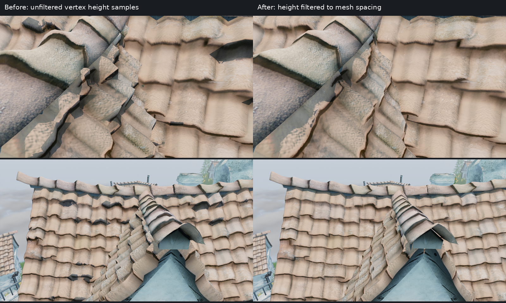

The final displacement fixture reports zero carrier-difference pixels, three cross-resolution difference pixels, 2,207 retained-relief pixels and 14,820 flat-silhouette pixels on both APIs. Replacing only its lit package with the prior material produces 2,115 carrier-difference / 2,360 cross-resolution pixels on Vulkan and 2,114 / 2,358 on OpenGL, failing the same thresholds. Both corrected GPU suites pass 37 cases with two existing original-reference skips and zero failures; the native host/CLI suites pass. An additional NOOP MeshStore case verifies that same-count UV0 or displacement-normal-magnitude changes return a full-upload error and that subsequent valid deformation succeeds.

The corrected native application completes 26 Vulkan sequences (832 frames), eight OpenGL sequences (256 frames), and four additional lighting controls (64 frames). Inspection covers both close roofs, original and generated textures, TAA/MSAA controls, three whole-scene tessellation configurations, stone wall, ledges, cliff, fort, ground, and static/moving/realtime capture modes. The lower/default/higher factors produce 16,652,411 / 19,355,485 / 19,390,415 whole-scene triangles; roof pixels remain nearly identical, so these are not claimed as three distinct roof mesh densities. In the static roof-a/roof-b/wall regions, the 99th-percentile maximum channel range across 32 frames is 3/4/3 RGB8 levels. Rain and reflections remain animated; full-frame differences are not classified as shadow flicker. Pale wall facets and authored ridge joins remain documented appearance limitations.

**Low-sun follow-up remains open.** At 08:00 and 16:00, hard polygon-shaped lit islands survive filtering. Matched previous-build captures contain the same islands, often with worse displaced folds. Contact-off removes the clipped boundaries; tessellation-off removes them too. These controls isolate interaction between contact visibility and displaced geometry, without proving an exact original-engine appearance. Two further experiments were rejected: a stable central-sun ray direction only changed the island outlines, while [Chiang et al.'s geometric shadowing factor](https://www.yiningkarlli.com/projects/shadowterminator/shadow_terminator_v1_0.pdf) still left islands and introduced broad triangular shading at noon. The method addresses bump-normal falloff; our attempted application did not resolve discontinuities in this coarse displaced mesh. Neither experiment is retained, and no test assertion was relaxed to accept them.

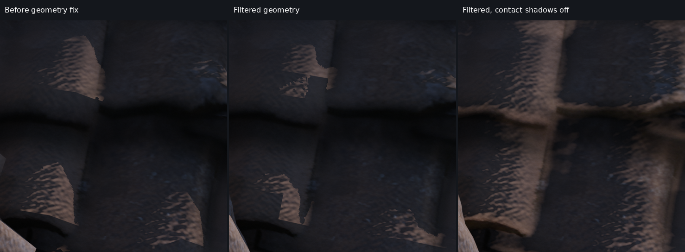

Four additional eight-frame contact-off/tessellation-off controls and two eight-frame previous-build lighting cases retain that diagnosis. `low-sun-controls/`, `low-sun-baseline/`, `sun-direction-experiment/`, `terminator-factor-experiment/` and the independent reviews retain the raw images and failed proposals. The first baseline invocation lacked executable permission and produced no images; its failure receipt is preserved separately. After all experiments, the restored corrected native executable is byte-identical to the acceptance candidate: SHA-256 `36f3074ea6c69a6f07253160cab964698ef97669905b88060a4780ca081a35bc`. Vendor sources and all unaffected packages match their saved originals. The successful filtering correction is retained; full roof acceptance is not claimed.

A separate real-time performance comparison uses the same roof-b camera, 1920×1080 Vulkan, R9700/RADV 26.0.8, 4K textures, MSAA4, visual-ultra-derived configuration, animated islands and no screenshot readback. Each run excludes a 2.05-second warmup and measures about 63 seconds. Previous versus corrected results are 12.18 versus 12.60 FPS (82.08 versus 79.37 ms/frame); asynchronous whole-frame GPU samples average 81.16 versus 78.58 ms. The last 60 one-second telemetry samples have median GPU utilization 100% in both runs and about 8.61 GiB VRAM usage. Both exit successfully, with no competing renderer/compiler workload observed. This single pair shows no performance regression and remains GPU-limited; it does not establish a repeatable speedup or make 100 FPS plausible at these settings. The geometric artifact is corrected even while frame rate remains low. `profiles/comparison.json`, both raw profiles, logs, executable hashes and telemetry retain the measurement.

Package review also records VA-24: OpenGL retains more pronounced/doubled tile-edge shading, small dark stipple and colored fringes than Vulkan. The matched retained pre-filter OpenGL roof-a capture already has this appearance; the filtering correction removes its large folded polygons without resolving the API difference. The current native and AppImage OpenGL roof-a pixels are identical, and roof-b differs only by one RGB8 level in a few channel samples. There is no retained old roof-b OpenGL capture for an exact historical comparison. This is a pre-existing observed appearance gap, not a demonstrated driver, material-filtering or packaging regression. Its rendering-stage cause remains unisolated.

The Docker-built AppImage also completes four Vulkan and two OpenGL 32-frame sequences through its relocated `AppRun`: both roof views, plus the Vulkan wall/cliff regressions. Every packaged frame, sidecar, configuration and process result is verified. Together with the native controls, this audit verifies 1,392 scene frames, including 16 retained-baseline frames. Native/package images are not universally byte-identical; paired full-frame and crop differences are recorded separately from the visual judgment that the corrected noon roof appearance is retained. Both final GPU suites again report 37 passes, two reference skips and zero failures after restoring the accepted materials. The 23 visual-runner tests and three host/CLI suites pass. The AppImage and all 679 frozen-source files are independently checked; later documentation, visual-manifest and deformation-test additions are explicitly distinguished from unchanged packaged runtime sources. See `final-verification.json`, `capture-verification.json`, `final-restored-gpu-receipt.json` and `release-linux/logs/frozen-source-verification.json` under the evidence directory. The package remains local and unpublished; Android builds remain deferred.

## Geometry height sampler and midpoint continuation

The October 4 continuation isolates a second displacement-sampling mismatch: the vertex height path shared the fragment sampler's anisotropy 8, so its explicit height LOD did not reproduce the intended isotropic filtered field on the tested driver. Vertex displacement now uses a separate isotropic trilinear sampler, while authored fragment-detail sampling retains anisotropy 8. Color, shadow and shared-depth displacement agree; the depth proxy height binding also uses trilinear minification rather than a mip-zero-only filter. The window material retains its screen-space reflection/sampler budget by reconstructing vertex trilinear height with integer texel fetches and clamping to the last mip of the actual bound texture, including partial chains and single-level placeholders. Displacement amplitude, distance fade, authored normal shading, receiver activation and vendor contact shaders remain unchanged.

The routed GPU fixture compares geometry while changing only fragment anisotropy, checks actual depth-proxy coverage, and requires retained relief. Restored Vulkan and OpenGL smoke both exit 0 with **34 passes, four skips and zero failures**. General fragment motion/depth mismatch is 0/0 on both APIs, with 1,855/1,856 retained-relief pixels. The window full-chain lit/masked-depth comparison differs by three pixels on Vulkan and two on OpenGL; the partial-chain comparison is exact on both APIs, retaining 2,053 relief pixels. Three mutations verify the oracle: sharing the anisotropic fragment height sampler fails with 68 moving geometry pixels; restoring mip-zero depth sampling fails with 539 coverage mismatches; assuming a complete window mip chain fails with 11,779 lit and 11,779 masked-depth mismatches and zero retained relief. Each negative exits 1; all mutations are restored before the final positive runs. The four skips cover the existing original-reference parity and unavailable audio cases, so these suites do not establish original-engine or audio-device acceptance.

Exactly twelve version-77 material packages change and the other 21 retain their accepted bytes. The sampler-only renderer completes five matched Vulkan poses (`roof-a`, `roof-b`, `roof-morning`, `roof-afternoon`, `stone-wall`), two frames per pose, with exit 0 and every frame/source/package snapshot hash verified. Effective settings differ from the accepted references only by isolated cache paths. Independent review retains noon tile/ridge relief and finds no broad new stone bevel/seam wedge; the stone crop has mean maximum-channel change 0.345084, with 206 of 320,000 pixels above 8. Morning agrees closely with an independent manual vertex trilinear control (mean maximum-channel change 0.171100; 62 pixels above 8), while its straight closing edge and the afternoon angular notch remain. Two-frame sequences do not establish temporal stability. **The sampler correction is validated within this matrix; the complete low-sun contact-shadow bugfix remains open.**

A separate native investigation finds that duplicate source edge 265--447 / 448--264 has identical endpoint position, normal and UV0, but subtraction-based CPU midpoint interpolation produces a one-ULP position mismatch at a quarter-edge point. Exact position/UV footprint sharing then misses the duplicate, yielding a one-mip LOD difference and about 7.214 mm of displacement separation in the reconstructed control. POSITION/UV0/UV1 midpoints now use symmetric interpolation while preserving raw-normal `glm::mix`, tangents, separate seam vertices and connectivity. Loose cache semantic version 34 and ZIP version 36 invalidate old geometry; archive migration accepts only current loose payloads and cannot resurrect `v33` results. The native reverse-edge/footprint and cache tests pass, and restoring only the old interpolation makes the new invariant fail at paired sample 1; the correction is then restored and the native suite passes again. This independently bounded seam fix does not prove a cure for the visible foreground source-patch-484 chord/contact boundary. Independent verification of the actual v35/v36 roof archives confirms that cached points 3309/3344 now share position/UV bits, footprint and 4K mesh LOD 6.426518658742741, instead of differing by one mip. Counts remain 17,389 vertices / 95,667 indices, the entire index buffer is identical, and normals, raw magnitudes, UVs and separate tangent frames retain their bytes.

The combined sampler/midpoint candidate completes another five matched Vulkan poses, two frames each, all exit 0 with every image/configuration/metadata receipt verified. Independent comparison to the sampler-only candidate finds no visible regression: first-frame full-image maximum differences are 2/1/1 RGB8 levels for noon roof-a/roof-b/wall and 2/3 for morning/afternoon. The hard morning closing line and afternoon clipped patches remain visually unchanged. These views do not establish a visible seam improvement; the midpoint correction is supported by the separate cache/native invariant. Both final combined-candidate Vulkan/OpenGL smoke suites exit 0 with 34 passes, four skips and zero failures. An initial OpenGL attempt selected Vulkan and failed the API-route check; its log is preserved and the explicit X11/OpenGL fallback rerun supplies the passing result.

A matched real-time roof-b performance pair uses the same 1920x1080 Vulkan/RADV 26.0.8 workload, animated islands and no screenshot readback. Both exit 0 and measure 793 frames after approximately two seconds of warmup: accepted baseline 63.032711 seconds / 12.580770 FPS, combined candidate 63.011089 seconds / 12.585087 FPS. The +0.0343% difference is effectively unchanged in this single pair, with no observed regression or repeatable speedup claim. Valid asynchronous last-completed GPU samples from exactly the last 793 rows average 78.616995 / 78.589441 ms; 20/17 unavailable samples are excluded, leaving 773/776 valid samples. Median GPU utilization over the last 60 telemetry samples is 100% in both; median VRAM is 9.648466 / 9.656934 GB. Both select 240 high-resolution and four original textures, 3,558,348,960 selected mip bytes, and 19,355,485 tessellated scene triangles. Texture fallback counters differ (11,652 / 11,603); the cause is unisolated, and the comparison does not claim identical fallback accounting. Effective settings differ only by isolated v35/v36 cache paths. Timings are a matched throughput observation, not contact-shadow acceptance or per-pass profiling.

Evidence is retained under `build/visual-audit/contact-shadow-continuation/`: both production capture directories, `midpoint-independent-review/`, source/package identities, final Vulkan/OpenGL smoke and preserved routing-failure logs, three sampler-mutation logs, midpoint positive/negative/restored native logs, and `midpoint-seam-prototype/independent-live-cache-seam-verification.json`. Sampler-only renderer SHA-256 is `85c3465419ddcf04d30b67db825cd117e3c20e70f81997d28c99894b0e006015`; the combined renderer is independently retained as executable `sampler-midpoint-renderer`, SHA-256 `824e88e516114ca652fd7a4e64d6f172d95fffce66087f5ead3f4aa61a066686`, matching its captures and performance receipt. `profiles/` retains both terminal receipts, raw profiles, telemetry and independent comparison; the earlier executable-permission failure is preserved separately and supplies no performance samples. Rejected physical-normal/proxy/visibility experiments remain diagnostic evidence and are not retained as production contact fixes. **No complete low-sun contact-shadow acceptance**, original-renderer parity, new package release or Android validation is claimed.

### Finite-Sun contact visibility and uniform publication

The October 4 native continuation identified two distinct contact-visibility errors. A SUN light's BRDF representative direction is not a visibility integral over its finite disc. Separately, `View::prepareShadowMapping` copied uniforms only when a cascade or spot shadow map was needed, clearing the directional-contact flag in SCREEN_SPACE-only frames. The retained shader integrates analytic actual-triangle self-occlusion and sixteen deterministic conditional solid-angle rays; `hasShadowing()` now preserves the manager's uniforms. The BRDF, normal maps, existing depth marcher, contact distance and per-ray quality steps are unchanged. The ordinary DIRECTIONAL fallback is verified separately.

The independent native oracle checks a 3-degree Sun at elevations -4, -2, 0, 2 and 4 degrees, with expected visible fractions 0, 0.109591, 0.5, 0.890409 and 1. Linear FLOAT readback checks every measured pixel and RGB means, with 120 accepted warmup and 32 measured frames per contact-on/off state. A separate raised blocker casts no cascade shadow in its measurement region and checks the continuous partial-visibility profile, full umbra and unobstructed exterior. Two ordinary DIRECTIONAL cases cover contact without overlapping caster/receiver shadow-map bounds. Restoring the old uniform guard makes the back-lit DIRECTIONAL case return fully lit and fails all three partial-Sun cases. Both corrected Vulkan and OpenGL runs finish with 35 passed, 4 skipped and 0 failed; the skips concern unrelated reference-parity/audio coverage. The sixteen-ray blocker maximum/mean profile errors are 0.131650/0.049325 on Vulkan and 0.131552/0.049263 on OpenGL, within the unchanged declared 0.15/0.07 bounds.

The verified sixteen-ray executable is `f38eb0f28660f927f31de85f40d51e2833c86f98e3ff652ad29991bf3ec42cdd`, with fifty-one frozen source/package/executable identities. Five registered poses on Vulkan and five on OpenGL each retain ten verified frames. The registered three-view temporal suite retains ninety-six more Vulkan frames. Morning/afternoon/wall crop maximum temporal standard deviations are 1.495/4.493/2.747 RGB8 levels, versus 11.873/40.299/18.780 for the retained sampler/midpoint baseline. Maximum peak-to-peak ranges are 6/19/11; this sampled stability result does not establish absence of every artifact. The afternoon spatial profile improves; the morning polygonal closing edge remains visible.

A serial afternoon profile used the same Vulkan device/driver, 1920x1080 effective settings, textures, 3,558,348,960 selected mip bytes, canonical cache bytes and 19,355,485 scene triangles. The baseline averaged 12.96294 FPS over 63.02583 measured seconds, after the excluded two-second warmup. Thirty-two rays averaged 10.61407 FPS over 63.02954 seconds, increasing mean frame time 22.13%; sixteen rays averaged 11.73716 FPS over 63.04762 seconds, increasing it 10.44% against that baseline. These are single serial runs with ordinary animated islands and differing GPU clocks, not isolated shader timings or precise repeatability bounds. Texture-fallback request counters varied despite identical selected resources, and their cause is unestablished. Complete profiles, telemetry, commands, receipts and independent comparisons remain under `build/visual-audit/contact-shadow-continuation/sun32-performance/`.

Twelve lit packages were intentionally regenerated for the finite-Sun path, retaining twenty-one package identities against the sampler/midpoint baseline. The vendor diff is distributed with verified public-base, patch and resulting-tree pins; a clean application and a second idempotent Filament bootstrap pass. Android rebuilding remains deferred. Native/package/bootstrap success is separate from full-scene visual acceptance. The user authorized bounded smoothing of the displaced geometry for the remaining morning cut; no experimental geometry correction is retained by this entry.

Two subsequent bounded scalar vertex-fairing controls preserve original topology, tangent frames and height footprints while applying the same correction in their participating color/depth routes. The 5 mm control completes five Vulkan poses / ten verified frames; 10 mm completes morning, afternoon and wall / six frames. Both reduce the morning lit island but retain a straight closing edge; doubling the bound shifts its traced edge by at most one pixel. The 172 CPU probes cover x1250–1410, y435–480, below the surviving edge at y418–424: complete self-occlusion there does not establish disappearance of the upper island. Both controls are rejected, and the previously tested SUN16 renderer/smoke bytes and all fifty source/package identities are restored. Further geometry representation work remains open; no additional native, temporal or performance result is claimed for these controls.

The next diagnostic reconstructs refinement from the original displaced triangle corners, using 17,389 measured GPU height samples that are byte-identical between Vulkan and OpenGL. A zero-smoothing morning control retains the roof outlines closely; a 10 mm Loop2 smoothing control completes morning, afternoon and wall captures but still leaves straight closing edges. The independent native fixture passes on both APIs with unchanged zero-coverage and 20 micrometre depth tolerances, including separate blocker preservation. Its first one-pixel raster classification failure and the subsequently verified frustum alignment remain recorded separately. These fixtures establish the participating geometry/depth contract, not the full visual fix or unchanged normal-map tangent interpolation. An offline 20 mm control leaves the dominant upper edge exactly unchanged: that edge is inside cached parent 21211, with unpinned, unclipped vertices whose corrections are only 2–5 mm. The remaining discontinuity follows the sampled triangle normals rather than the movement cap. Uniform Loop3 reduces typical face-angle jumps but retains angular transitions; an actual-displaced PN fit is rejected offline because its target derivatives still jump across patch boundaries.

An independently reviewed continuous Loop limit target addresses that missing continuity in the inspected interior. Eighty regular, unprotected patches have a maximum certified Bernstein-control displacement of 14.438 mm relative to the original GPU raster. Complete polynomial comparisons across 102 shared edges agree in position and normal to float64 error; exact camera-ray probes broaden the morning transition without the former discrete face jumps. This is CPU evidence at full fade and reference amplitude 0.7. The complete regular-patch census finds 402,848 patches within the internally chosen 20 mm envelope, 136 above it and 107,240 excluded boundary, irregular or protected patches. Boundary joins, conforming sampling, dynamic fade behavior, resource cost and new GPU scene acceptance remain open. All experimental parent routes are removed from live sources, both restored executables match the previously verified SUN16 bytes, and all fifty renderer source/package identities agree. Evidence and independent reviews remain under `build/visual-audit/contact-shadow-continuation/`; no bounded geometry correction or complete VA-23 fix is accepted yet.

The subsequent coupled fit uses one shared Loop control mesh, with pinned points fixed, so position constraints do not require clipping individual patches. Independent replay certifies all 402,984 regular patches within the exploratory 20 mm envelope. An orientation repair changes 209 actual common controls affecting 444 regular patches; all regular patches then pass complete degree-six projected-normal certificates against their original displaced faces, and 532 affected shared edges retain their complete position and first/second derivative traces. The focal field remains unchanged. These are local orientation certificates, not a global self-intersection or runtime-fade proof. The complete indexed roof component contains 83,968 faces and 1,152 boundary pins. An isolated OpenSubdiv v3_6_1 CPU reference constructs compatible Loop/Gregory patches whose position envelopes stay below 12.503 mm, but four Gregory patches fail the orientation check and still require coupled repair. A separate conforming focal sampler passes the measured 2 mm / 0.5 degree criteria on 98,738 triangles, including its transition collar, and covers all 2,201 registered analytic pixels with maximum geometric self-occlusion error 0.03591. Float32 absolute-world rounding adds substantial normal error on its smallest triangles; camera-relative rounding performs better, with actual carrier arithmetic still under review. Boundary orientation, complete sampling cost, float32/native and matched scene acceptance remain open. Live renderer and smoke binaries still match the retained SUN16 versions, and scene totals remain 60 groups / 184 sequences / 848 frames.

A further coupled native repair fixes those four Gregory orientation failures by changing fifteen free common controls. Independent replay accepts all 118,814 native Loop and 3,482 Gregory position envelopes within the exploratory 20 mm bound, their complete local orientation gates and separately checked finite corner frames. All 48,774 internal adaptive joins retain matching normals, but the explicit infinite-corner approximation adds normal jumps beside boundary pins: the worst sampled jump is 53.852 degrees versus an old raster dihedral of 1.287 degrees. This is a known regression risk outside the reported focal box, not complete-component smoothness acceptance. The first composed diagnostic has 258,755 triangles and 240,967 parent-local records, preserves all original corner attributes and parent coverage, and moves sampled vertices by at most 10.381 mm. Independent serialized float32 replay finds no gaps, degenerate triangles or reversed winding. A separate 20 mm native color/depth fixture passes both APIs with unchanged zero-coverage and 20 micrometre depth requirements; the earlier synthetic-fold and one-pixel coverage failures remain preserved. Zero-smoothing morning controls differ from retained SUN16 by at most three RGB8 levels on each API. The first smoothed Vulkan and OpenGL images round the reported straight morning closure while retaining relief detail; the inspected wall differs by at most one level. Broader temporal checks, protected-corner correction, reusable generation and user visual acceptance remain open. The guarded payload and host route are diagnostics, and no complete VA-23 fix or release approval is established.

The completed r4 diagnostic covers five Vulkan poses and four OpenGL roof poses. Its three registered Vulkan temporal sequences retain 96 frames with independently recomputed statistics. In the expanded morning crop including the upper closing edge, mean/p95 temporal variation falls slightly, but the maximum rises from 1.495 to 1.763 RGB8 levels at (1309,405); the afternoon maximum rises from 4.493 to 6.205 at (1139,758), near a roof silhouette. The wall maximum remains 2.747. These mixed results do not establish a stability improvement everywhere. Actual exported chords confirm a protected endcap regression of 55.431 degrees against an old raster dihedral of 1.287, so this geometry is not retained. The renderer and smoke executables are restored byte-for-byte to the tested SUN16 versions, with fourteen saved and fifty reference source/package identities verified. Frozen diagnostics remain available. The scene ledger is 66 groups / 198 sequences / 966 frames, including the historical ineffective three-sequence / six-frame PN control; at most 195 sequences / 960 frames can support causal comparisons. Protected-border treatment and reusable geometry generation remain in progress.

The protected two-to-seven-ring r4 band subsequently restored all 2,300 measured protected endcap chords while retaining the rounded focal morning closure. Frozen five-pose Vulkan and OpenGL captures and three temporal sequences are independently verified. The afternoon crop maximum returns to 4.202 RGB8 levels, below retained SUN16 4.493; the expanded morning maximum remains 1.763 versus SUN16 1.495 at an unchanged focal pixel. The complete ledger contains 69 groups / 211 sequences / 1,082 frames, with the historical ineffective PN controls still excluded from causal evidence. This remains a camera-selected diagnostic, without an accepted reusable component builder. Its payload and material route were removed from live sources.

The reusable native height-sampling batch uses the actual uploaded height texture and the same transformed UV footprint, repeat, trilinear mesh-LOD sampling as production displacement. Its standalone native fixture and full Vulkan/OpenGL smoke suites finish with 36 passed / 4 skipped / 0 failed on each API. Only the new sampling package is added; the existing 33 packages retain the preceding SUN16 identities. This is a tested prerequisite with no production geometry-correction consumer. The current binary therefore includes this helper and must not be identified by the earlier SUN16 executable hash.

On October 4 the user directed a switch to small isolated rendering-feature scenes if the reusable contact geometry repair was not close. Geometry experiments are stopped at `build/visual-audit/contact-shadow-continuation/geometry-analysis/geometry-experiment-stop-checkpoint.json`; no further candidate is installed. The new procedural scene catalog, feature-specific inputs and repeatable captures are documented in [RENDER_TEST_SCENES.md](RENDER_TEST_SCENES.md). VA-23 remains open, and none of these results grants physical-device or release acceptance.

### Bounded displaced-surface continuation

**October 4, 2026 — resumed at the user's request after the rendering-feature test scenes were completed.** The dense bounded smoothing diagnostic rounds the expanded morning closing edge in Vulkan and OpenGL. The matched zero-correction control preserves that edge, so this observation depends on the changed geometry. All seven diagnostic capture groups verify independently: 16 sequences / 122 frames, including the five retained poses on both APIs and three 32-frame Vulkan sequences. Movement stays within 18.182 mm of the original full-amplitude source raster chord. The expanded morning comparison is `(1220,390)–(1450,495)`; the earlier crop beginning at y=425 omitted the upper closing edge. These runs used the retained diagnostic executables and are not qualification of the generic production builder. Evidence is under `contact-shadow-continuation/resume-20261004-common-limit/`, including `diagnostic-captures-independent-verification.json` and `morning-both-api-comparison.png`.

The matched native profiles reject this diagnostic density as the default implementation: 1,473,356 focal triangles shared by nine instances add 13,212,972 rendered triangles. Both profiles complete at least 63 seconds after two seconds of warmup with matching camera, effective configuration, assets, GPU and driver. Throughput falls from 11.634 to 6.156 FPS; mean frame time rises 88.99% and GPU time rises 90.23%. The candidate also reports 30 additional texture fallback/missing events; their cause is not assigned by these profiles. The profile receipts, telemetry, terminal logs and independent verification are retained in `diagnostic-performance/`. No speed claim is inferred from synchronized image capture.

The new generic startup/reload path samples actual uploaded height textures and keeps original packed tangent frames, height mip footprints, source-parent ancestry and runtime distance fade. Color and depth materials share the same parent-chord reconstruction and bounded correction. Frozen `generic-integration-5` native fixtures pass on both Vulkan and OpenGL, and its complete host suite passes. They exercise original, zero-correction and bounded geometry under four displacement/fade states, strict color/depth coverage, a 20-micrometre physical depth oracle, independent blockers and finite-Sun visibility. Vulkan's observed geometric depth error is below 10 micrometres; blocker invariance uses pixels physically owned by the blocker in both independent CPU oracles. This test caught and corrected an early-return bug that had skipped the depth material's eye-depth epilogue. These synthetic results do not establish removal of VA-23 in the full scene. Frozen `generic-integration-6` additionally passes rotation, translation, scale 0.75 and dynamic parent-fade controls on both APIs; the selected physical depth oracle stays below 4.1 micrometres on Vulkan and 0.52 micrometres on OpenGL. Its actual-application isolated displacement runs verify four cases / eight frames per API, including one prepared source and an explicit distance-LOD fallback. The framebuffer-Y pilot examines both orientations before selecting the valid oracle; large depth witnesses from the discarded pilot do not describe an accepted check. A lower-cost generic sampling policy, full-scene captures and matched performance remain open. The unqualified dense prototype is not installed as an asset-specific runtime route.

The generic carrier preserves original-corner packed tangent bytes and the original displacement direction field, but regenerated child shading frames are recomputed from interpolated authored normals and UVs. Exact inheritance of the old GPU lighting interpolation is not claimed: retaining fragment material bodies and normal maps does not establish that stronger condition. The real-roof zero-correction diagnostic supplies a separate appearance control (at most three RGB8 channel levels over the whole morning view). The isolated scene review catches a new OpenGL lit-appearance regression in `generic-integration-6`: tessellation-enabled scenes lose checker textures and the red marker, including unprepared objects. A matched frozen baseline retains those textures and a visible ground-relief difference. Passing mask/depth fixtures and structural capture receipts do not qualify this broken output; its startup-sampling/resource cause is under investigation.

The next generic sampler starts from original parent triangles rather than requiring the native subdivision atlas as its raster floor. Startup first freezes native source fields, ranks their displacement-induced angular energy across the authored instance population, and refines within separate source, target-work and rendered-triangle budgets. A per-triangle scheduling control reached capture after 20.84 seconds of geometry preparation but skipped the roof; it is an allocation control, not a refined-roof reference. The instance-weighted total-energy control in frozen `generic-integration-10` places the repeated roof first without an asset, camera or light selector: 31,889 source triangles become 249,487 unique triangles shared by nine instances, with a sampled maximum correction of 19.849 mm. The scene adds 1,999,578 rendered triangles under a two-million ceiling and completes geometry preparation in 22.36 seconds, versus the earlier 420-second application timeout. Its two verified morning Vulkan frames round and shrink the upper lit region but retain a shorter angular closing contour; the dense diagnostic remains smoother. The requested approximation quality is still explicitly unmet. These captures establish progress, not complete VA-23 acceptance or a performance result.

The authored ninth roof transform retains constant homogeneous W=0.999994993 instead of exactly one, with zero spatial terms in its bottom row. Preparation now accepts finite positive constant W while retaining all matrix values, original fade semantics and the raw spatial scale; the movement cap is enforced after the homogeneous divide. Frozen `generic-integration-9` passes mixed W=0.8/1, rotation, translation and scale controls on Vulkan with the unchanged 20-micrometre physical depth and exact interior-coverage gates. A subsequent amplitude-four stress control exercises 836 clamped parent attachments but fails that same depth gate at 23.536 micrometres; its raster-conditioning investigation remains open. Neither the synthetic constant-W fixture nor its disabled culling establishes general transformed-frustum acceptance.

The OpenGL investigation separates sampling cleanup from material-package changes. Bypassing sampling retains the new packages and original GPU surfaces and restores checker textures. A diagnostic that retains all sampling resources also restores textures in two written frames, then aborts at Engine shutdown because a retained material still has an instance; it is not an accepted lifecycle implementation. Retaining only the temporary headless swapchain finishes normally but does not restore textures. The attempted bound-program destruction guard likewise fails to improve output and has been removed byte-for-byte. Matched frozen `generic-integration-10` enabled cases still reproduce the texture regression. View and material-instance cleanup controls are the next isolation steps; no speculative vendor patch is accepted from these tests.

The OpenGL cleanup regression is now identified and corrected with the existing upstream Mesa buffer-deletion workaround. Native tracing shows temporary View UBO 77 deletion changing the actual generic uniform-buffer binding from 4 to 0 while the cache retains 4; the first persistent MaterialParams ranges are then zero despite correct indexed buffer/texture bindings. The actual AMD OpenGL driver reports vendor `AMD` and Mesa in `GL_VERSION`, so vendor-only detection missed it. The production predicate now checks vendor or version; it frees all resources normally, with no retained GL names, cache flush, shader workaround or diagnostic logging. The distributed patch and bootstrap pins reproduce this change, clean and idempotent bootstrap succeeds, and all 18 offline bootstrap tests pass. `opengl-descriptor-trace-v4-independent-verification.json`, `opengl-mesa-workaround-independent-verification.json` and `mesa-buffer-workaround-production/` retain the causal trace and independent receipts.

A new real-backend `height_sampler_lit_lifecycle` regression samples actual procedural DDS height input during startup, checks a textured checker floor and red marker in final SDR pixels, and repeats two sampler teardowns in the same Engine. The original Mesa predicate fails with zero red-marker pixels and checker contrast -0.389 RGB8; the fixed predicate passes on Vulkan and OpenGL with 18 red-marker pixels, checker contrast above 178 and at most two RGB8 levels of change after teardown. Frozen `generic-integration-15` complete native suites each finish with 40 passes, four skips and zero failures; host tests pass. The initial full-suite insertion before cumulative build-once checks produced two expected counter-history failures; moving this scene-reload test after those checks preserves their assertions and the failed receipt. These checks qualify the resource repair and synthetic geometry controls, not removal of the remaining full-scene roof contour.

The constant-W amplitude-four fixture was also conditioned without changing geometry, amplitude, cap branch, depth limit or the other cameras: its dedicated cap camera now faces the receiver plane normally. Frozen native 13 exercises the same 836 clamped attachments and a 26.129-mm attempted correction, with exact interior coverage and at most 11.084 micrometres of physical depth error under the unchanged 20-micrometre gate. Native 11's oblique-camera failure remains preserved, and a hypothetical subpixel-quantization analysis is diagnostic rather than a claim about exact GPU rasterization. The general constant-W fragment-lighting/culling limitation remains explicit.

A matched native performance control with independently culled prepared house instances completes 62.985/63.025 measured seconds after warmup: baseline 11.654 FPS versus candidate 10.805 FPS, a 7.85% mean-frame-time increase. This control uses the original 250k per-surface/two-million rendered-addition budgets and the retained Mesa predicate diagnostic executable; it does not qualify later surface-level culling or larger geometry. The new budget-capped morning Vulkan capture completes in 47.5 seconds, with the shorter angular closing contour still visible. Same-target CPU density sweeps and negative scheduling controls are retained separately; increasing to 1.5 million unique roof triangles still leaves the focal parent at 64 raster cells and a sampled 3.865-degree normal error, so triangle count alone is not accepted as a fix.

The frozen `generic-integration-16` density-only control raises the roof to 999,487 unique triangles shared by nine placements, adding 8,708,382 rendered triangles. Its morning Vulkan and OpenGL captures both complete normally, preserve the restored material textures and approach the earlier dense focal reference, while retaining a short flatter contour. The matched performance pair completes 62.994/63.041 measured seconds after warmup: 11.636 versus 10.025 FPS, a 16.069% mean-frame-time increase; GPU mean time rises 16.454%. This uses prepared-surface bounds, preserves all original shadow settings and does not qualify the subsequent spatial draw partition. The default source was restored byte-for-byte after the diagnostic build. The independent capture and performance receipts are `generic16-density-1m-morning-independent-verification.json`, `generic16-density-1m-morning-opengl-independent-verification.json` and `prepared-surface-1m-performance/independent-verification.json`; VA-23 remains open.

The subsequent spatial-range implementation permutes complete triangle triplets into conservative contiguous draw ranges without changing vertices, winding or triangle multiplicity. The camera-aware constant-W containment guard fails closed for unsupported origins and inconclusive bounds. Frozen `generic-integration-19` host and complete Vulkan/OpenGL suites pass; native one-million-triangle focal crops remain byte-identical to the earlier surface control. Increasing the unchanged target to 2,999,485 unique roof triangles materially rounds the remaining closure in two native Vulkan frames, but adds 26,708,364 rendered triangles and retains unmet global approximation quality. A per-request working-set estimate rejects an unsuccessful secondary target earlier, reducing preparation from 126.148 to 30.306 seconds while retaining the same prepared roof counts, bound and contour. The matched three-way Vulkan measurement completes 62.957/63.006/62.987 measured seconds: baseline 11.675 FPS, one-million 10.221 FPS and three-million 8.605 FPS. The three-million diagnostic initially remained separate because of that frame-time cost. The cheaper common-control curvature fit is rejected before GPU capture: its registered connector barely improves and its protected-band normal jumps regress. The user subsequently accepts the cleaner three-million geometry and measured cost for high visual quality; that policy is promoted in the final integration below. An OpenGL full-index-buffer control preserves both focal frames but still takes 159.057 seconds, providing no observed capture-wall-time benefit; its backend branch is reverted. Capture wall time does not identify a rendering bottleneck. The independent receipts and preserved source/build artifacts are under `resume-20261004-common-limit/`; broader scene, temporal, API and final performance acceptance remain open.


**Accepted geometry integration, October 4.** The user selects the cleaner three-million-triangle geometry and accepts its measured cost for high visual quality. Frozen `generic-integration-22` installs the generic static-surface policy without a mesh, camera, light or preset-label selector: at most three million triangles per surface, 128 times source density and 27 million added rendered triangles including every authored instance. Native height samples, original packed tangent frames, raw normal magnitudes, UV footprints, parent chords, authored amplitude and runtime fade remain preserved. Physical smoothing is limited to 20 mm. The roof prepares 31,889→2,999,485 unique triangles shared by nine placements, adding 26,708,364 rendered triangles with sampled movement 19.849 mm. Sixteen components are accepted; five components containing 5,527 source triangles retain their original geometry after orientation rejection. The global 0.5-degree approximation goal remains unmet, including preserved C0 bands; this is a bounded visual correction rather than a globally converged surface.

The final evaluator honestly charges the fifteen native evaluations in each patch-envelope visit. Independent replay remains byte-exact in all five target/geometry/quality/fallback streams and uses 67,359,739 evaluations under the 96-million surface ceiling. Scene work remains capped at 128 million evaluations, four million native sample requests and 1 GiB of frozen source arrays. The working-set estimate allows 2 GiB only above 1.5 million requested triangles, otherwise 1 GiB; it is not a hard RSS limit, and the standalone roof replay peaks near 2.02 GiB. The final native scene prepares one surface and retains 393 others, conservatively charging the remaining failed attempt. Startup preparation in the final morning Vulkan capture is 30.287 seconds. The matched prior equivalent three-million candidate measures 8.605 versus 11.675 FPS over at least 62.957 measured seconds after warmup: mean frame time rises 35.6752% and GPU time 36.2149%. This profile uses the afternoon camera at 16:00, 1920×1080, 4K textures, all recorded high-quality features, tessellation factor 1.8 and foliage density 1.95 on the same R9700/RADV device. Independent source and draw-count review establishes applicability to the final equivalent geometry; it is not a final-binary remeasurement, OpenGL throughput result or universal FPS threshold.

The final renderer, native smoke harness and host tests build and finish successfully. Each native API reports 40 passes, four skips and no failures. Five retained cameras produce ten verified frames per API; both final morning closure crops match the accepted candidate byte for byte and retain readable roof and wall relief. Three 32-frame Vulkan temporal sequences add 96 verified frames with matching camera, simulation step, effective settings and driver. Expanded morning crop temporal standard deviation mean/p95 falls from 0.545515/0.649519 to 0.542296/0.636611 RGB8, while its maximum rises from 1.494783 to 1.575880. Afternoon maximum falls from 4.493050 to 4.344537; wall maximum rises from 2.746980 to 2.819955. Afternoon peak-to-peak and consecutive-frame maxima nevertheless rise from 19/15 to 21/21 RGB8 levels. These mixed statistics do not establish universal stability improvement. Four maintained displaced-contact on/off cases also complete on each API with eight verified frames and successful receipt/input/effect QA per API; checker textures, relief and the red blocker remain visible. At that checkpoint the final capture scope is five groups, 21 sequences and 132 frames; the complete 87-case isolated matrix has not yet been rerun. Before/after pixels, exact terminal receipts, independent source/image reviews, temporal statistics and the performance applicability proof are retained under `resume-20261004-common-limit/` in `final-contact-shadow-before-after.png`, `final-native-and-capture-terminal-receipts.json`, `final3m-independent-verification.json`, `final3m-temporal-vulkan/` and `prepared-spatial-final-density-performance/final22-applicability-review.json`. The approved geometry is installed; user visual sign-off for VA-23 and the separate physical-platform release gates remain open.

The October 5 continuation completes the previously omitted full isolated-feature matrix without changing the final source or binaries: 87 cases and 474 retained frames per native API, 174 cases and 948 frames total, with 17 procedural scenes and 40 complete pairs. Both runner and reusable QA processes finish with exit 0; all application receipts and input-activation checks pass, and independent reviewers inspect all 34 scene sheets. The eight focused displaced-contact frames on each API remain byte-identical to the preceding final-build captures. Against v3, the three displacement-on recipes change as expected; every other OpenGL frame is byte-identical. The sole unrelated Vulkan difference is confined to bright grass seedheads. Four targeted repeats retain eight more verified frames and reproduce the same variant in the preserved pre-fix renderer, establishing pre-existing repeat variation without identifying its underlying cause. The old and final grass source, inputs and material package match. Current full-matrix receipts, registered metrics and independent comparisons are under `build/visual-audit/render-test-scenes/final3m-20261005/`; the prior 132-frame original-scene/temporal/focused qualification remains a distinct scope. [RENDER_TEST_SCENES.md](RENDER_TEST_SCENES.md#rebase-review-and-scope) records the still-open weak bloom/transparent-shadow controls, instancing/skinning parity and effect-appearance gates. These broader integration checks preserve the approved contact fix and do not close VA-23 user visual sign-off or physical-platform release acceptance.

The subsequent authored-asset layer adds four compact original-node groups alongside the procedural controls: roof/stones, island/fir, windows/lamps and mill/flag animation. Frozen renderer `26fd09cb388e40afc12ee12d976faf8ebda5177cd6f3ec98efbf52f8ef01772a` completes 18 cases and 96 frames on each native API, with runner and reusable QA terminal exits 0 and no input or receipt flags. Actual node provenance, material bindings, texture counts and Heaven/sibling-core byte identities are retained. Both native smoke suites pass 42 checks with two reference-image skips, and the host suite includes strict missing-input, collision-world replacement and benchmark-marker rebinding checks. Contact/displacement/grass/local-shadow responses are visible; weak authored bloom/cutout controls, lamp-only glass response and skinning residuals remain explicit image gates in [RENDER_TEST_SCENES.md](RENDER_TEST_SCENES.md#real-asset-layer). These 192 authored frames are a separate baseline under `build/visual-audit/render-test-scenes/real-assets/`, not a replacement for the prior procedural, original-scene or physical-device qualifications.

**October 5, 2026 — bloom and CPU-skinning follow-up.** The weak authored bloom control exposed an app-side lens-dirt composition defect: Filament multiplies the complete bloom accumulation by the dirt texture, while the app supplied a dark sRGB map with dirt strength 0.2. The corrected app path converts the unchanged original map into linear RGBA16F gain `1 + 0.2 * dirt` and binds strength one; the procedural dirt pattern uses the same conversion. Clean bloom is retained with bounded dirt modulation. Source emission, threshold, anti-firefly settings and vendor shaders remain unchanged. A separate strength-ownership correction respects the caller's `bloom_strength`, exposes it through configuration/CLI/live UI and refreshes cached lighting for strength-only changes. Default request 0.3 preserves the prior day/night strength curve exactly; bloom-on appearance intentionally changes because the old attenuation is removed. The centered original-lamp view at this default retains a smooth warm halo on both APIs, with maximum brightening +86/+85 RGB8 in a local ring outside a conservative projected glass box. The matched bloom-off pilot is byte-identical to its prior control. Gain source/cache/lifetime accounting and the bounded request contract are documented in [FILAMENT_RENDERING_FEATURES.md](FILAMENT_RENDERING_FEATURES.md).

The CPU skeletal fallback previously discarded UV-aligned tangents by uploading animated data through the static route and rebuilding a normal-only frame on updates. Startup and tessellation re-upload now preserve the animated source type, and CPU updates pack the supplied UV tangent with the matching handedness convention; the existing GPU-skinning flag still chooses CPU-updated vertices or GPU bones. Source animation/materials and the separate cloth/static-deformation path remain unchanged. The authored 32-frame paired maxima fall from 85/86 to 17/5 RGB8 on Vulkan/OpenGL, with three residual pixels above two per API; exact arbitrary-animation pixel parity is not established. All GPU-on animation frames and unchanged authored recipes outside the corrected CPU route retain their prior pixels. Cutout and refraction recipes receive focused original-asset framing: the PCF receiver exposes fractional fir-mask shadows, while the older PCSS control still hides that fine response; a separately matched zero-thickness control establishes local lamp-glass refraction shift. Temporary coverage/thickness/absorption diagnostic sources and packages are restored. No production alpha-shadow or glass-material policy change is inferred, and the solid-glass approximation remains.

Frozen final renderer `070f005f21f390695208310429ac3d88611dd15dc9ecec50def996754616ac39` completes 18 authored cases/96 frames, four focused displaced-contact cases/eight frames and eight bloom guards/16 frames on each native API: 60 cases/240 frames total. Both authored, focused-contact and procedural-white runners and reusable QA finish with exit 0 and no input/receipt flags; complete original-scene noon/dusk guards use strict capture replay rather than feature-scene QA. Independent checks replay source/asset provenance, effective paired configurations, frame clocks, logs and image/metadata/configuration hashes. All 16 focused contact PPMs are byte-identical to the approved three-million-triangle integration. Both full native suites report 43 passes, two reference-image skips and no failures; the host suite passes. The new bloom state/cache fixture uses a private NOOP Engine and does not substitute for GPU halo review. The final 574 frozen source/binary identities and all 73 recorded material/source/package/generated/cache/vendor preservation identities match.

Original-scene noon/dusk and procedural emissive/white guard sheets are inspected on both APIs: surfaces remain readable, lamp bloom spreads smoothly, and no image collapse or broad rainbow artifact is observed. The pure-white on/off controls have maximum difference two RGB8 levels and no pixels above two on either API; these negative controls need not produce a halo. Sparse original-scene specular-edge differences remain explicit rather than being reported as halo strength or universal firefly parity. This is scoped SDR image inspection, not a floating-point optics/finite-radiance proof, a new complete 87-case matrix replay, VA-18 baked-window compression closure, VA-23 user visual sign-off or physical-platform release acceptance. Frozen sources, exact receipts, paired/guard sheets, gain review and residual witnesses are retained under `build/visual-audit/render-test-scenes/real-feature-fixes-20261005/`, particularly `final-independent-review/` and `bloom-gain-independent-review/`. Historical weak-control evidence remains preserved.

## October 9 lamp-glass emission and reflection

The original `lamp_post.node` binds `building_glass`, whose inherited material uses `building_lamp_d/n/s/e.dds`. The original night variant `building_glass_on` enables emission with scale 2.5 and white tint, retaining its specular map and normals. Its highlights use specular power 8 and Fresnel bias/power 0.2/3; it authors no reflection cubemap. The modern Filament glass already supplies dielectric Fresnel, IBL/SSR and transmission, but its early cache return bypassed surface emission setup and night-state registration, and `heaven_glass` declared no emissive inputs. The correction adds emission through one shared binder for opaque and refractive routes without changing the existing glass normal, tint, roughness, IOR, thickness, reflection or transmission settings. Bulb emission follows operating state independently of the camera-axis flare. Non-lamp refractive glass requires authored emission eligibility; core default emission textures must not make arbitrary panes glow. The established warm tint/minimum-scale approximation is retained consistently across both routes, so this is not a replay of the original specular or emission calibration.

The native `glass_refraction` case retains its unavailable/disabled routing controls and adds an isolated production-material FLOAT32 fixture with no flare, visible sky or direct light. It checks daytime creation, same-hour cache rebuild, night restoration and authored/default-map eligibility. Night mean RGB is `(12, 7.199219, 2.398438)`; day and returned-dark RGB are zero; restored and oblique views agree within the registered bounds. With emission off, zero diffuse SH irradiance and a black transmission background, red/blue reflection cubemaps produce `(0.111084, 0, 0)` / `(0, 0, 0.111084)` on both APIs. Nine tracked native resource-owner counts return to baseline. These are independent emission/reflection oracles, not original-engine visual parity.

Four maintained real-mesh cases in `tests/visual/lamp_glass_lighting.json` frame the actual bulb at night/day and 25 degrees off axis with flares, bloom and particles disabled. Both native runners and unchanged strict authored-resource/sequence QA pass all four cases/eight frames per API, with no missing, unexpected or activation/receipt flags, using complete loose inputs at `extracted/heaven`. The glass remains visibly emitting off axis at night and textured/reflective in daylight. Separately matched frozen-renderer Vulkan before/after captures retain twelve frames: the daytime pair is byte-identical, while night changes remain on the actual bulb, including the off-axis view. The earlier accidentally low camera poses are retained as weak stimuli, not used as bulb evidence.

The canonical helper builds and targeted strict Clang 21 checks pass. Only `heaven_glass.filamat` changes; the other 33 material packages and Filament patch remain unchanged. Seven host checks pass with the opt-in graphical check separately skipped; both complete native rendering suites report 50 passes, four existing skips and zero failures. Final renderer SHA-256 is `308c6e06321580bfb40f0ca2c63eb8fc089b2d887a417dcd0b449b25610a9a7d`; smoke harness is `76556845e46e56d5cb14b63af8df73824a3caf6a8236a682683057d6273fdde3`. The initial test link failure from an unexported boolean getter and a tiny-cubemap Vulkan failure remain preserved. The final oracle uses the production sky's 64-wide level-zero upload and generated mip chain; the earlier tiny FLOAT-to-HALF upload failure is not silently treated as production correctness or a proven driver diagnosis. A documented enum-flag static-analysis repair produces the same tested harness bytes.

The matching ARM64 development APK is 20,726,231 bytes, SHA-256 `c675be7964c6c738a473b2ae3c7b54dc8597d10875cf77d2525035fc718cf56a`, installed and readback verified on the OnePlus tablet. Two flare/bloom-free low-settings actual-lamp trials complete in roughly five/six active seconds, with thermal status 0, peak sampled CPU 58.3°C and battery 24.7°C. Saved settings restore byte-exactly and rendering stops. Night glass is visibly emitting; daytime tablet glass is brighter than desktop, and pre-existing window-surround flecks remain, so cross-device pixel parity and full-scene/endurance acceptance are not established. Evidence, frozen binaries, complete strict receipts, independent native pixels, retained failures and comparison images are under `build/lamp-glass/20261009/`. No new Filament patch, release publication or broad platform sign-off is implied.

## October 9 smoke density and lamp flare follow-up

The follow-up report identified faint daytime smoke and lamp halos that remained visible in daylight and away from the viewing axis. Smoke already used correct premultiplied `transparent` blending and scene lighting, but its procedural per-puff alpha was only 0.10/0.12 before shape and lifetime attenuation. The retained correction doubles optical depth with `a * (2 - a)` after those factors, preserving soft edges, particle geometry/motion, diffuse lighting and premultiplication. The original engine's material alpha is not substituted directly: its sprite atlas and attenuation maps have different coverage. This is a bounded readability correction, not original-engine parity or volumetric smoke transport.

The independent `particle_lighting` test subtracts black/white background readbacks to isolate transmission from smoke radiance. Uncovered corners calibrate the background step. The fixture uses RGBA32F blending/readback to avoid accumulated FP16 subtraction error, bounds finite signal values and retains all ambient/color/point-light/return-state/resource controls. Measured Vulkan mean/peak opacity changes from 0.09756/0.47168 to 0.16963/0.71865 for dark smoke and 0.11413/0.53784 to 0.19471/0.78476 for white smoke; OpenGL agrees closely. Candidate light-dependent transmission error is at most 3.58e-7. The preceding FP16 baseline and its white-smoke calibration failure remain as evidence; format precision differs between those captures. New density bounds reject that thin baseline while retaining translucent cores.

Enclosed lamp/lantern glass emission and lamp-source candela now share a smooth gain derived from the original day-cycle phase keys (00:00/05:15/18:45/21:00). This approximates the original per-group stepped material/light switches. Daytime lamp gain is zero; open flame and unrelated window/accent sources retain independent behavior. An authored light receives the schedule only when associated with a unique bounded lamp enclosure. Lens flares read the live source candela, including explicit power-off and retirement, and apply the requested camera-axis policy: full within 5 degrees, smooth fade to zero at 20 degrees. Existing distance/depth occlusion and floating anchors remain active. Source illumination is independent of that angular halo gain.

The canonical helper build and strict Clang 21 checks pass. Only `heaven_smoke.filamat` changes; the other 33 packages and the retained Filament patch hash remain unchanged. Seven host suites pass with one opt-in native skip. Both complete native GPU suites pass with 50 cases, four existing skips and no failures, including actual cached/new/rebuilt material emission, FOCUSED_SPOT state, live power, off-axis/occluded flare and recovery controls. The final desktop renderer SHA-256 is `8ebfe326c352afbf4b136addc1f8bbaa1fd232ad5c3070efe1e31acb0c03ed21`; the smoke harness is `dffc048ec4cb25e204759f7c8748f8cf0e28b70bfabae43c7698e73572c459c8`.

Matched actual-scene Vulkan before/after captures retain 48 frames with identical camera/time/effective visual settings. The first tower/boiler poses were weak smoke stimuli because of geometry, heat haze and bright backgrounds; their images remain qualified rather than being treated as a density oracle. A closer laboratory view isolates haze/fog and retains a modest visible density change. Lamp night flare-off output is byte-identical before/after; night illumination is preserved. Actual-mesh lamp on/off pairs on both APIs retain a strong centered-night response (maximum 215 RGB8), while daytime and 25-degree look-away pairs have no changes above 2 RGB8. Independent native FLOAT32 testing supplies the opacity evidence; full-scene plume readability still needs user visual acceptance.

Four short low-settings OnePlus trials cover day/night smoke and real house/lamp meshes. Each renderer stays live through touch/screenshot collection, then stops; saved configuration hash `37d65207…` is restored byte-exactly. Thermal status stays 0, maximum observed live CPU temperature is 63.7°C and battery temperature 24.5°C. The verified installed APK is `f041d36d7fbfe7f9f654336d6e67ff133b51ef8cfff60f13023213108206dd75` (20,711,143 bytes), with matching signing certificate and installed-package readback. ADB supplied controls/screenshots; scrcpy remains unavailable. The pre-existing window-surround bright flecks remain visible and are not resolved by this change. These brief trials do not establish sustained performance, endurance or full Android appearance acceptance.

Evidence is under `build/smoke-flare/20261009/`: frozen sources/binaries, baseline and focused transmission receipts, complete suite terminals, material-preservation manifest, matched scene frames, maintained lamp pairs, strict QA reports, APK source/object/package bindings and device trials. `tests/visual/smoke_lamp_visibility.json` preserves six actual-mesh lamp controls and two full-scene chimney views. Strict authored-resource QA against `assets/` reports four texture fallbacks already present in the preceding night-lighting lamp captures: three optional cloud DDS files and lens dirt are absent from that package. The 24 matched material texture bindings have no unmatched entries. Replaying the six final lamp cases on each API with the complete loose input root `--data extracted/heaven` passes the unchanged strict QA: 12 cases, 24 frames, zero input/receipt flags. Centered-night pairs retain maximum 215 RGB8 response, and daylight/look-away pairs remain within 2 RGB8. The packed-input failures and an initial wrong-root attempt remain as evidence; this source correction does not regenerate the incomplete asset package.
